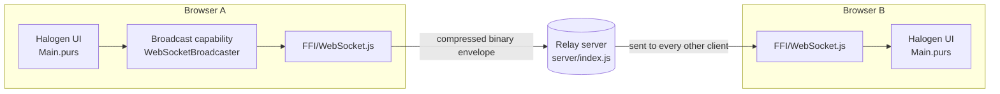
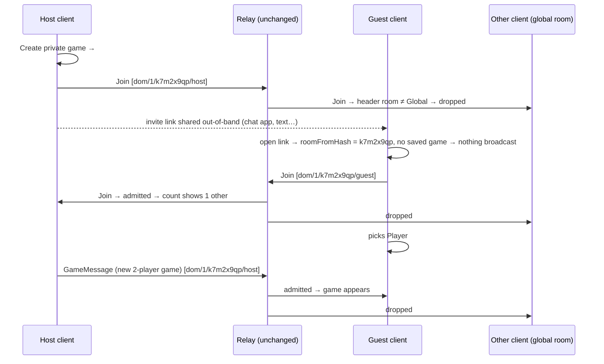

# Matchmaking Design Proposal

- **Date:** 2026-10-31
- **Status:** Iteration 1 (MVP) implemented. See [§12 Implementation Notes](#12-implementation-notes). Later iterations are tracked in [`issues/TODO-matchmaking.md`](../issues/TODO-matchmaking.md).
- **Issue:** [#8 Design a match-making system](https://github.com/bagrounds/domination/issues/8)
- **Supersedes:** the "Potential Approaches" list in [`issues/TODO-matchmaking.md`](../issues/TODO-matchmaking.md)

## 1. Summary

Today every Domination client is in one shared game, because the relay server
sends every message to every connected client and every client acts on every message.

This proposal adds **rooms**. A room is a named group of clients that share one game,
one chat and one presence count. Rooms are built entirely in the client:

1. **Iteration 1 (MVP): invite links.** A player clicks *Create private game* and gets a link
   like `https://domination.fun/#room=k7m2x9qp`. Anyone who opens the link is in that room.
   Clients add the room to every message they send and drop messages addressed to other rooms.
   No link means the **global room**, which works exactly like today.
2. **Iteration 2: discovery.** Hosts can choose to list an unstarted room. Listed rooms
   announce themselves to the global room on a timer. Clients in the global room show
   the announcements as a list of *Open games* with a *Join* button.
3. **Later, optional:** seat claiming, catch-up for late joiners, retiring the shared
   global game, and routing on the server by room if traffic ever needs it.

The server, the deployment and the binary layout of messages do not change in iteration 1.
Current clients keep working, and they can still talk to new clients in the global room.

## 2. Goals and Constraints

From the issue:

| # | Requirement | How this design meets it |
|---|---|---|
| R1 | Not everyone is always in the same game | Rooms isolate game, chat and presence (§5) |
| R2 | No new infrastructure or external services | No server change, no database. The link is the only thing shared (§5.3) |
| R3 | The socket server stays a dumb relay; logic lives in the client | The server is untouched. Room logic is pure PureScript in the client (§5.4) |
| R4 | Iteration 1: create a game and invite others | *Create private game* plus *Copy invite link* (§5.6) |
| R5 | Later: discover and join unstarted games | Soft-state room listings in the global room (§6) |
| R6 | Smooth evolution from the current system | Same wire layout. The global room is today's behaviour. Message headers carry a version (§5.2, §7) |
| R7 | Use the existing languages and frameworks | PureScript, Halogen, the capability classes and the existing codecs. No new dependencies |
| R8 | The MVP is as small as possible | About 7 small changes, listed in §8 |

Non-goals for the MVP: secrecy (§9.1), automatic pairing or skill ratings, accounts, and seat
assignment beyond the existing *Player #* control.

## 3. How It Works Today

### 3.1 Components



- **Relay server.** `server/index.js` keeps a `Set` of sockets. Each incoming message goes
  to every other open socket. It has no rooms and does not read message contents.
  It is hosted on Render (`render.yaml`).
- **Transport.** `src/FFI/WebSocket.js` opens one WebSocket per window. Incoming data is
  dispatched as a DOM `CustomEvent` on `#remote-message-target`, which `Main.purs`
  receives as `ReceiveRemoteMessage`. `makeWebSocketFFI` already takes a `roomCode`
  argument, but it is only passed along on reconnect.
- **Envelope.** `Message.WireEnvelope = Tuple String WireMessage`, meaning (sender id,
  message). It is encoded with the vendored `arraybuffer-class` codec
  (`lib/Data/ArrayBuffer/Class.purs`) and compressed with lz-string
  (`Capability/WireCodec.purs`).
- **Messages.** `Message.RemoteMessage`: `ChatMessage`, `UsernameMessage`, `GameMessage`
  (the whole game state plus a move counter `i`), `PlayMadeMessage`,
  and the presence messages `JoinMessage`, `HeartbeatMessage` and `LeaveMessage`.
- **Presence.** Each client sends a heartbeat every 5 s and drops peers it has not heard
  from for 15 s (`AppState.defaultHeartbeatInterval` and `defaultHeartbeatTimeout`).
  The number of live peers is shown in the corner. It counts *other* clients, because
  the relay does not echo a client's own messages. This is the protocol from
  `plans/client-connection-tracking.md`.
- **Game sync.** Every move broadcasts the full `GameMessage`. On receipt the client adopts
  the incoming state, keeping its own seat (`playerIndex`), and saves it.
  Each player picks a seat by hand with *Player #* in Settings → Game.
- **Persistence.** `localStorage` holds `game_state` and `game_state_0` to `game_state_9`
  (for undo), `chat`, `player-id`, `username`, `kingdom`, `player_index`, `player_count`,
  `bot_strategies`, `bot_delay` and `server-url`.
- **Placeholders.** `AppState.roomCode` exists and is always `globalRoomCode = "global-dev"`.
  `sendMessage` passes it to `maybeCreateBroadcaster`, but nothing else uses it.

### 3.2 UI

- A gear button opens Settings, which has the tabs **Game** (player count, *Player #*,
  *Start N Player Game*, *Load Game*, long-game toggle), **Bots**, **Kingdom**,
  **Connection** (server URL, username) and **Debug**.
- The rest of the screen is the game area, the chat with the game log, and the
  connection count.

### 3.3 Facts that shape the design

1. **Every client receives everything.** The relay broadcasts to all. Any isolation built
   in the client is isolation, not privacy (§9.1).
2. **Receivers ignore the sender slot.** `Main.purs` matches the decoded envelope as
   `Right (Tuple _ msg)`. The first field of `WireEnvelope` is never read, so a new
   meaning can be given to it without breaking current clients.
3. **Clients of different versions share one relay.** `domination.fun` (GitLab Pages,
   `master`) and the preview `bagrounds.github.io/domination` (every GitHub push) are
   built separately but use the same `defaultServerUrl`. Both install a cache-first
   service worker (`assets/sw.js`), so old builds keep running for a while. Any protocol
   change must work alongside old clients from day one.
4. **Adding a constructor to `WireMessage` is a breaking wire change.** The generic codec
   encodes a sum type as nested `Either` tags of one byte each. Appending a constructor
   changes the encoding of the current last constructor (`LeaveWireMessage`). Decoders
   also `throw` on malformed input (for example "Incorrect Tuple encoding"). Changing the
   envelope shape would therefore make old clients throw or misread messages.
5. **Startup broadcasts the saved game.** `Initialize` calls `loadGame "game_state"`, which
   sends a `GameMessage`. If saved games were not separated by room, a guest opening an
   invite link would send their old game into the new room and overwrite it.
6. **Decoding is prefix-based.** `decodeArrayBuffer` reads from offset 0 and ignores any
   trailing bytes. A `Tuple` writes its first field first. So the bytes of
   `Tuple String WireMessage` start with the bytes of the `String`, and
   `readWire :: String -> m (Either String String)` on a received message returns just the
   first field. The client can read a header before decoding the body.

> **Verified.** Facts 4 and 6 were checked with a throwaway PureScript program against the
> vendored codec (`npx spago run`):
>
> | Experiment | Result |
> |---|---|
> | Encode `Tuple "dom/1/k7m2x9qp/3b2f-uuid" chatMsg`, decode as today's `Tuple String WireMessage` | `Just (Tuple "dom/1/k7m2x9qp/3b2f-uuid" (ChatWireMessage "u" "hello" (WireInt 3)))`: old clients are unaffected |
> | Decode the same bytes as a bare `String` | `Just "dom/1/k7m2x9qp/3b2f-uuid"`: the header can be read first |
> | Encode a reshaped envelope `Tuple "sender" (Tuple "k7m2x9qp" leaveMsg)`, decode as today's type | Throws `Incorrect ArrayBuffer encoding - retreived length, but not all values` |
> | Encode the last constructor of `V1 = Chat String \| Leave String`, decode as `V2 = … \| Leave2 String \| Listing2 String` | Throws |
> | The reverse: encode `Leave2 "client-1"` (V2), decode as V1 | **Silently misreads** as `Leave ""` |

## 4. Research

| Source | What we take from it |
|---|---|
| Valve, [Steamworks Matchmaking & Lobbies](https://partner.steamgames.com/doc/features/multiplayer/matchmaking) | The standard model. A **lobby** is like a chat room. Users create one, attach metadata, search by metadata, join, and wait "until there are enough players ready to launch the game". Steam recommends creating lobbies "only when needed… when the user invites a friend to play". Friends join from an invite link. One lobby owner arbitrates. We use the same steps: create, invite, (later) list and search, join, start. |
| Epic Online Services, [Lobbies guide](https://dev.epicgames.com/docs/epic-online-services/multiplayer/lobbies-and-sessions/lobby-interface/lobbies-guide/lobbies-guide-intro) | Same model: players "form teams, select pre-game options… and wait for additional players to join them before they start the game". This confirms that "discover and join **unstarted** games" is the normal second step. |
| Saltzer, Reed & Clark, [End-to-End Arguments in System Design](https://web.mit.edu/Saltzer/www/publications/endtoend/endtoend.pdf) (ACM TOCS, 1984) | A function that only the endpoints can implement correctly belongs at the endpoints. A network-level version is at most a performance optimization. Room membership is application logic, so it goes in the client, and server routing stays an optional optimization (§6.4). |
| Eugster et al., *The Many Faces of Publish/Subscribe* (ACM Computing Surveys 35(2), 2003) | Our relay is topic-based pub/sub with one topic. Topics can be filtered at the subscriber or at the broker. Filtering at the subscriber needs no broker change. Moving the filter to the broker later only saves bandwidth. |
| W3C TAG, [Good Practices for Capability URLs](https://www.w3.org/TR/capability-urls/) | Invite links are capability URLs. Guidance: use unique, hard-to-guess identifiers. Assume URLs leak (history, referrers, chat logs). Tell users what sharing a link allows. |
| [RFC 3986 §3.5](https://www.rfc-editor.org/rfc/rfc3986#section-3.5) | "The fragment identifier is separated from the rest of the URI prior to a dereference… dereferenced solely by the user agent." A `#room=…` link never reaches a server, which suits static hosting on two different paths. |
| MDN, [`Cache.match`](https://developer.mozilla.org/en-US/docs/Web/API/Cache/match) | Cache matching includes the query string unless `ignoreSearch` is set. Our service worker calls `caches.match(event.request)`, so `?room=` URLs would miss the offline cache. `#room=` URLs do not affect cache lookups. |
| MDN, [`hashchange`](https://developer.mozilla.org/en-US/docs/Web/API/Window/hashchange_event) | Changing only the fragment does not reload the page. We must listen for `hashchange` to handle a pasted link or the Back button. |
| [RFC 9170](https://www.rfc-editor.org/rfc/rfc9170), *Long-Term Viability of Protocol Extension Mechanisms* (IAB, 2021) | A version or extension point that is never used stops working. We put a version in the header from the first release and make receivers ignore versions they don't know. |
| [RFC 9413](https://www.rfc-editor.org/rfc/rfc9413), *Maintaining Robust Protocols* (IAB, 2023) | Accepting malformed input liberally causes problems later. We define the header and room-code grammars exactly, reject anything else, and leave room for growth inside those grammars on purpose. |
| Clark, *The Design Philosophy of the DARPA Internet Protocols* (SIGCOMM 1988); Raman & McCanne, *A Model, Analysis, and Protocol Framework for Soft State-based Communication* (SIGCOMM 1999) | **Soft state**: state kept alive by periodic refresh and dropped when refreshes stop. Recovery from crashes and partitions is automatic. Presence already works this way. Room listings in iteration 2 will too. |
| Danilo Sato, [Parallel Change (expand / migrate / contract)](https://martinfowler.com/bliki/ParallelChange.html) | How to make a breaking change safely. Add the new form (expand), move clients over (migrate), then remove the old form (contract). Our rollout follows these steps (§7). |
| Kleppmann, *Designing Data-Intensive Applications*, ch. 4 "Encoding and Evolution" | With rolling upgrades, old and new code must read each other's data in both directions. The compatibility table in §7.1 checks this. |

## 5. Iteration 1 (MVP): Invite-Link Rooms

### 5.1 Domain language

| Term | Meaning |
|---|---|
| **Room** | A group of clients that share one game, chat and presence count. Either the **global room** or a **game room** with a code. |
| **Global room** | The room you are in without an invite link. It behaves exactly like today, and old clients are always in it. |
| **Room code** | The short identifier of a game room, for example `k7m2x9qp`. |
| **Invite link** | The app URL with `#room=<code>` added. Opening it puts you in that room. |
| **Header** | The first field of the wire envelope: protocol version, room and sender. |
| **Admission** | The receiver's decision about a message: *admit*, *foreign room* or *unsupported protocol*. |

```purescript
-- new module: src/Data/Room.purs  (Domination.Data.Room)

newtype RoomCode = RoomCode String        -- constructor not exported
roomCode :: String -> Maybe RoomCode      -- smart constructor; grammar in §5.2

data Room = GlobalRoom | GameRoom RoomCode
derive instance eqRoom :: Eq Room

data Protocol = LegacyProtocol | Protocol1
type Header = { protocol :: Protocol, room :: Room, sender :: String }

data HeaderError = UnsupportedVersion String | InvalidRoomCode String
data Admission = Admit | ForeignRoom | Unsupported HeaderError

printHeader :: Header -> String
parseHeader :: String -> Either HeaderError Header
admission   :: Room -> String -> Admission      -- my room, raw header
scopedKey   :: Room -> String -> String         -- storage key for this room
roomFromHash :: String -> Room                  -- "#room=k7m2x9qp" -> GameRoom ...
roomHash    :: Room -> String                   -- inverse, for links and Leave
```

All of these are pure and total, so they can be property tested (§10).

### 5.2 Wire format: give the unused sender slot a header

The envelope type does **not** change: it stays `Tuple String WireMessage`. Only the
contents of the first `String` change:

```text
header        = versioned-header / legacy-header
versioned-header = "dom/" version "/" rest  ; version 1 is defined below; others are reserved
v1-header     = "dom/1/" room "/" sender
room          = "*" / room-code          ; "*" means the global room
room-code     = 1*32( %x61-7A / DIGIT )  ; a-z 0-9, lower case
sender        = 1*VCHAR                  ; the existing player id
legacy-header = sender                   ; only when the string does NOT start with "dom/"
```

Parsing is ordered, so the two forms never overlap. If the string starts with `dom/`, it
must be a valid versioned header, or it is an error. Otherwise it is a legacy header.

| Header | Parsed as |
|---|---|
| `3b2f…-uuid` (sent by current clients) | `{ protocol: LegacyProtocol, room: GlobalRoom, sender }` |
| `dom/1/*/3b2f…` | `{ protocol: Protocol1, room: GlobalRoom, sender }` |
| `dom/1/k7m2x9qp/3b2f…` | `{ protocol: Protocol1, room: GameRoom k7m2x9qp, sender }` |
| `dom/2/…`, `dom/x/…` | `Left (UnsupportedVersion …)` (message dropped) |
| `dom/1/K!/…` | `Left (InvalidRoomCode …)` (message dropped) |

Why this format:

- **Fully compatible on the wire.** Current clients ignore the slot (§3.3.2). They decode
  new messages exactly as before, without exceptions or misreads.
- **Read before decoding the body.** A receiver decodes the header with
  `readWire :: … (Either String String)` (§3.3.6). Messages for another room or an
  unknown version are dropped **before** the `WireMessage` body is decoded. This is what
  lets later versions change the body safely: clients from this release never try to
  decode a body they don't understand.
- **The version is used from the start** (RFC 9170), so the `"dom/2/"` path in iteration 2
  will meet receivers that already ignore unknown versions.
- **Exact grammars** (RFC 9413). Generated codes use 8 characters from the
  Crockford-style alphabet `0123456789abcdefghjkmnpqrstvwxyz`. That is a strict subset of
  `room-code`, so generation can change later without breaking parsers. Codes are
  lower-cased before validation because people retype them.

### 5.3 Where the room comes from: the URL fragment

- The invite link is `<origin><pathname>#room=<code>`, so it works for both
  `https://domination.fun/` and `https://bagrounds.github.io/domination/`.
- Use the fragment, not the query string or the path. The static hosts and the relay
  never see it (RFC 3986 §3.5). The cache-first service worker still serves the app
  offline (MDN `Cache.match`). No server routing is needed.
- A missing fragment or anything other than a valid `room=<code>` means `GlobalRoom`. An
  invalid code is also logged and shown as a notice in Settings.

### 5.4 Client behaviour

All room logic is in the client. In `Main.purs`:

1. **State.** Replace `roomCode :: String` (always `"global-dev"`) with `room :: Room`.
   `maybeCreateBroadcaster` keeps its `String` argument and receives `roomHash room`. The
   WebSocket transport ignores it, and the old Bugout transport would use it as its swarm
   name, so rooms would also work there.
2. **Initialize.** Read `location.hash`, compute `roomFromHash`, store it, then do
   everything else as today using **room-scoped storage keys** (5.5).
   In a `GameRoom`, Initialize loads the saved game **locally only**. It does not broadcast
   it. Today `loadGame` both loads and broadcasts. Split it into `restoreGame` (local) and
   `shareGame` (broadcast): *Load Game* and *Undo* still do both, and startup does both
   only in the global room, as today. A member who reloads after missing moves therefore
   cannot roll the room back. They catch up at the next move, or at once with catch-up on
   join (§6.3).
   If the room is a `GameRoom` and has no saved game, open Settings on the **Game** tab so
   the host sees the invite link and guests see *Player #*.
3. **Send.** In `sendMessage`, replace `Tuple id message` with
   `Tuple (printHeader { protocol: Protocol1, room, sender: id }) message`.
   Nothing else in the send path changes.
4. **Receive.** In `ReceiveRemoteMessage`:
   ```text
   detail ──readWire──▶ header :: String
          ──admission room──▶ Admit ──readWire──▶ WireEnvelope ──▶ existing dispatch
                              ForeignRoom / Unsupported _ ──▶ drop (debug log only)
   ```
   Because filtering happens before dispatch, chat, game sync, presence count, username
   updates and the PING/PONG reply are all limited to the room without changing their
   handlers.
5. **Change room.** Subscribe to `hashchange` in the same way as `beforeunload`, with a
   new `RoomChanged` action that reloads the page. Reloading runs `Finalize` (sending
   `LeaveMessage` to the old room) and then `Initialize` (sending `JoinMessage` to the new
   room), so there is no separate room-switch code path to get wrong.
   - `CreateRoom`: generate a code, then set `location.hash = "room=<code>"`.
   - `LeaveRoom`: set `location.hash = ""`.
   - Pasting a link into the address bar, or pressing Back, uses the same path.

New effects go behind existing capabilities:

| Need | Where |
|---|---|
| Read the hash, set the hash, reload, read origin and path | New methods on the `Dom` class (`src/Capability/Dom.purs`), implemented with `Web.HTML.Location` from the existing `web-html` dependency |
| Generate a room code | Existing `Random` capability (`randomIntBetween`). Codes only separate rooms; they are not secrets, because every client receives every message anyway (§9.1) |
| Copy the invite link | Existing `FFI.copyToClipboard` (used today by *Copy bug report*) |

### 5.5 Storage scoped by room

```purescript
scopedKey GlobalRoom   key = key                                  -- unchanged keys, no migration
scopedKey (GameRoom c) key = "room/" <> unwrapCode c <> "/" <> key
```

Apply it to `game_state`, `game_state_0` to `game_state_9` (undo) and `chat`. Everything
else (`player-id`, `username`, `kingdom`, `player_index`, `player_count`, `bot_*`,
`server-url`) stays global, because it is a personal preference rather than room state.

This fixes the problem in §3.3.5. A guest opening an invite link has no saved game for the
room, so `Initialize` has nothing to load and cannot overwrite the host's game. Even with a
saved game, members of a room never broadcast on startup (§5.4.2). Two tabs in different
rooms keep separate games.

### 5.6 UI

Add a **Room** section at the top of Settings → **Game**, since starting a game already
happens there. There are two states:

```text
┌ Game ─────────────────────────────────────────────┐   ┌ Game ─────────────────────────────────────────────┐
│ Room: Global (everyone without an invite link)    │   │ Room: k7m2x9qp · 2 others here                    │
│ [ Create private game ]                           │   │ Invite link: [https://domination.fun/#room=k7m…]  │
│                                                   │   │ [ Copy invite link ]  [ Leave room ]              │
│ Players: [-] 2 [+]   Player #: [-] 1 [+]          │   │ Anyone with this link can join and see the game.  │
│ [ Start Short 2 Player Game as Player 1 ]  …      │   │ Players: [-] 3 [+]   Player #: [-] 1 [+]  …       │
└───────────────────────────────────────────────────┘   └───────────────────────────────────────────────────┘
```

The last line of the game-room panel is the user notice recommended by the Capability
URLs note (§4). Optionally, show the room code next to the connection count in the corner
so players can see which room they are in. This is not required and can be dropped.

### 5.7 End-to-end flow



### 5.8 Out of scope for the MVP

- **Catch-up for late joiners.** A guest who arrives after the game starts sees it at the
  next move, which is today's behaviour. See §6.3.
- **Seat claiming.** Seats are still chosen with *Player #*. Duplicate seats are possible,
  as today. See §6.3.
- **Bots in rooms.** They work, but only one member should configure them, as in the
  global room today.
- **Spectating, kicking, passwords, room titles, discovery.**

## 6. Later Iterations

### 6.1 Iteration 2: discover and join unstarted games

Following the Steam and EOS model: list, filter, join, wait until ready, start.

- **Opt in.** Add a *List this game publicly* checkbox in the room panel, off by default.
  Unlisted rooms behave exactly as in the MVP.
- **Listing message.** Do not add constructors to `WireMessage`, because that shifts the
  existing encoding (§3.3.4). Do not add a new body type either, because pre-MVP clients
  would still try to decode it as a `WireMessage` and throw or misread it. Instead, send
  each listing in a **body shape that old clients already decode harmlessly**, and let
  the header tell new clients how to read it:
  ```purescript
  type RoomListing = { room :: RoomCode, host :: String, seats :: Int, members :: Int }

  -- sent as:  Tuple "dom/2/lobby/<sender>"
  --                 (UsernameWireMessage (Tuple listingJson ("listing/" <> code)))
  _listingWire :: Prism' WireMessage RoomListing   -- JSON via Argonaut, already a dependency
  ```
  - **Pre-MVP clients** decode it as an ordinary `UsernameMessage`. All they do is
    `HashMap.insert id username` into their username table under the key
    `listing/<code>`. That key never appears as a chat sender, so nothing is shown. The
    table grows by one entry per listed room, which does not matter.
  - **MVP clients** drop it unread, because `dom/2/…` is an unsupported version (§5.2).
  - **Iteration 2 clients** see `dom/2/lobby`, decode the body with `_listingWire`, and
    reject anything that does not match.
  - Game, chat and presence messages keep using `dom/1/…`, so MVP and iteration 2
    clients play together in the same room.

  Iteration 2 therefore does not need old clients to disappear first. This matters
  because `assets/sw.js` has no `skipWaiting` or `clients.claim`, so open tabs and
  installed PWAs can keep running an old build for a long time. A dedicated
  `LobbyWireMessage` body only becomes safe when every client checks the header first,
  which is iteration 3 at the earliest.
- **Who announces.** For the smallest version, only the member who ticked *List this game
  publicly* announces, every heartbeat (5 s), while the room is **unstarted** (no game has
  been sent or received in it). The listing settings live only on that member's client,
  so no other member could announce correctly. If that member leaves, the listing expires.
  Starting a game stops the listings.
  *Later:* to let another member take over, first share the listing settings with all
  members, then choose the announcer as the lowest id among **self ∪ live peers**. Peers
  alone are not enough: `connectedClients` excludes the local client, so in a two-member
  room each member would choose the other and neither would announce.
- **Soft-state lobby.** Clients in the global room keep a
  `HashMap RoomCode { listing, lastSeen }` and drop entries not refreshed within 15 s,
  reusing the heartbeat constants and the stale-client pruning in `Main.purs`. No message
  is needed to remove a listing: it expires (Clark 1988; Raman & McCanne 1999).
- **UI.** Add an **Open games** list in Settings → Game while in the global room, with
  host name, *members/seats* and a **Join** button that sets `#room=<code>`. Full rooms
  are hidden. Optionally, add **Quick join**: join the open room with the most members,
  or create one if there is none (Steam's steps 2 and 3).

### 6.2 Iteration 3: retire the shared global game (contract)

When old clients are rare (see the version reported in the Debug tab), the global room
becomes a **lobby only**. Starting a game always creates a room, and the global room shows
*Open games* and lobby chat. This is the contract step of Parallel Change.

### 6.3 Small additions that can come in any order after the MVP

- **Catch-up on join.** When a `JoinMessage` arrives in a room, the member with the lowest
  id that has a game resends its latest `GameMessage`. One responder per join, chosen as the
  lowest id among **self ∪ live peers** that have a game (§6.1 explains why self must be
  included).
- **Seat claiming.** Add the seat to presence data, so the *Player #* control can disable
  taken seats. For conflicts, follow Steam's single-owner rule: the lowest live member id
  decides.
- **Room titles and kingdom summary** in listings.

### 6.4 Optional, only if traffic needs it: routing by room on the server

Every client receives every room's traffic, so bandwidth grows with total activity. That
is fine at the current scale. If it becomes a problem, the relay could route by a topic in
the connection URL (`wss://…/?topic=<room>`) without reading message contents. That keeps
the server a content-agnostic pub/sub broker (Eugster et al.). By the end-to-end
argument, it would only be an optimization: clients would keep filtering by header and
stay correct with or without it. It is listed so the design has a path to scale, not
because it is planned.

## 7. Compatibility and Rollout

### 7.1 Compatibility matrix (iteration 1)

| Sender ↓ / Receiver → | Old client | New client, global room | New client, room X |
|---|---|---|---|
| Old client | as today | admitted (legacy → global) | dropped |
| New client, global room | admitted (header ignored) | admitted | dropped |
| New client, room X | admitted ⚠️ | dropped | admitted |
| New client, room Y | admitted ⚠️ | dropped | dropped |

⚠️ **A known cost of the transition, accepted on purpose.** Old clients cannot filter, so
they adopt game and chat messages from every room. They save those games under their
global keys and may send them to the global room on their next startup. The global room
can therefore receive some private-room games while old builds are still running.
This is the same kind of interference as today, where any player can overwrite the one
shared game, but it now has more sources.

- **Contained to the global room.** Messages from old clients are admitted only in the
  global room, so private rooms stay isolated from old clients in both directions.
- **Temporary.** It ends as browsers load the new build (§7.2).
- **Can be removed** with server routing by an opaque room topic (§6.4). That is the only
  way to protect clients that cannot filter, and it is not worth its cost for a
  transition period.

### 7.2 Rollout (Parallel Change)

1. **Expand (iteration 1).** Ship the MVP to the GitHub preview, then to `domination.fun`.
   Bump the version (`scripts/bump-version`) so the service-worker cache name changes and
   browsers fetch the new build. No server deploy and no data migration are needed,
   because global storage keys are unchanged.
2. **Migrate.** Leave time for old builds to disappear (installed PWAs update on a later
   launch). The global room keeps old and new players together meanwhile.
3. **Ship iteration 2** whenever it is ready. Listings use a body that every older build
   decodes harmlessly (§6.1), so this step does not have to wait for old clients to
   disappear. Optionally, add `skipWaiting()` and `clients.claim()` to `assets/sw.js` so
   later builds reach users faster.
4. **Contract (iteration 3).** Retire the shared global game.

**Rollback.** Reverting the MVP restores today's behaviour. Room-scoped keys
(`room/<code>/…`) are simply ignored, and the global keys were never changed.

## 8. MVP Change List

| # | File | Change |
|---|---|---|
| 1 | `src/Data/Room.purs` (new) | `RoomCode`, `Room`, `Protocol`, `Header`, `Admission`, the `parse`/`print` header codec, `admission`, `scopedKey`, `roomFromHash`/`roomHash`, room-code generation over `Random` |
| 2 | `src/Capability/Dom.purs` | `locationHash`, `setLocationHash`, `reload` and `pageBaseUrl`, for `AppM`, `DomM` and `HalogenM` |
| 3 | `src/AppState.purs` | `roomCode :: String` → `room :: Room`. Remove `globalRoomCode` |
| 4 | `src/AppAction.purs` | `CreateRoom`, `LeaveRoom`, `RoomChanged`, `CopyInviteLink` |
| 5 | `src/Main.purs` | Read the room on `Initialize`. Scope storage keys. Split `loadGame` into `restoreGame` and `shareGame`, and skip `shareGame` at startup inside rooms. Header in `sendMessage`. Check the header first in `ReceiveRemoteMessage`. Subscribe to `hashchange`. Handle the 4 new actions |
| 6 | `src/UI/Settings.purs` | Room panel in the Game tab (§5.6) |
| 7 | `test/Main.purs` | New "Rooms" section (§10) |

No changes to `server/`, `src/FFI/WebSocket.js`, `Message.WireMessage`, `WireEnvelope` or
the deployment.

## 9. Risks and Mitigations

### 9.1 Isolation is not privacy

The relay sends every message to every client, so a modified client can read or join any
room. Room codes keep honest clients apart; they do not protect anything. This is no
weaker than today, where every message is already public. The room panel says so (§5.6).
Real privacy would need the server-side topics in §6.4 combined with hard-to-guess codes,
or end-to-end encryption with a key in the fragment. Neither is needed for a friendly
card game.

### 9.2 Other risks

| Risk | Mitigation |
|---|---|
| A guest's leftover game, or a stale game after a reload, overwrites the room's game | Storage scoped by room (§5.5). No startup broadcast inside rooms (§5.4.2) |
| A guest plays in the placeholder game before the host starts | The Game tab opens automatically in a room with no game. Starting a game replaces any earlier state, as today |
| A malformed or hostile link (`#room=<script>`) | Strict `roomCode` validation, falling back to the global room with a notice. Halogen escapes text anyway |
| Room code collisions | 32⁸ ≈ 1.1 × 10¹² codes. Very unlikely with a few concurrent rooms |
| A future body change crashes older clients | Header checked before the body, unknown versions dropped, version used from the first release (§5.2) |
| Pasting a link in the same tab does not reload | `hashchange` → reload (§5.4) |
| Two tabs in one browser share `player-id` | Same as today. Their games are now kept apart by room |

## 10. Test Plan

These follow the existing `test/Main.purs` style, using QuickCheck where it fits.

**Property tests (pure)**

1. Header round trip: `parseHeader (printHeader h) == Right h` for any valid header.
2. Legacy compatibility: any string without the `dom/` prefix (for example a UUID) parses
   as `{ protocol: LegacyProtocol, room: GlobalRoom, sender: s }`.
3. Unknown versions: `dom/<v>/…` with `v ≠ 1` gives `Left (UnsupportedVersion v)`. No
   string starting with `dom/` ever parses as a legacy header.
4. `admission r (printHeader { room: r', … }) == Admit` exactly when `r == r'`.
5. `roomCode` accepts exactly `[a-z0-9]{1,32}` after lower-casing. Generated codes always
   pass.
6. `roomFromHash (roomHash r) == r`.
7. `scopedKey GlobalRoom` is `identity`. `scopedKey (GameRoom c)` is injective and never
   returns a key that `GlobalRoom` uses.

**Wire compatibility tests (effectful, using the existing `writeWire` and `readWire`)**

8. A message sent with a v1 header decodes with today's `WireEnvelope` type to the same
   `WireMessage`. This shows old clients are unaffected.
9. `readWire` returns the header string alone for any encoded envelope. This shows the
   header can be read first (§3.3.6).

**Manual check** with the local relay (`cd server && npm start`, then set the server URL to
`ws://localhost:8081` in the Connection tab):

10. Tabs A and B in the global room and tabs C and D in room X. Chat and moves in X reach
    only C and D. Each pair sees its own connection count.
11. Opening the invite link in a new tab, with an old saved game in the global room, does
    not change room X's game. Reloading a member of room X does not send a `GameMessage`.
12. Pasting a different room link into a tab moves it to that room. The old room's count
    drops after `Leave`.

Automating checks 10–12 as browser-driven property tests is tracked in
[`issues/TODO-e2e-browser-tests.md`](../issues/TODO-e2e-browser-tests.md).

## 11. Alternatives Considered

| Alternative | Why not (for now) |
|---|---|
| **Rooms on the server** (route by `?room=`) | Puts application logic in the relay and needs a coordinated Render deploy, against R3. Clients would still need to filter for correctness (end-to-end argument). Kept as an optional optimization (§6.4) |
| **New envelope type with a room field** | Changes the binary layout. Old clients would throw or misread messages (§3.3.4), so a coordinated switch of all clients at once would be needed. Reusing the unused sender slot avoids this |
| **A server URL per group** (the Connection tab already allows it) | Needs a new server per group: new infrastructure (R2) |
| **Per-room WebRTC / Bugout swarms** | Bugout is dormant and depends on public WebTorrent trackers, which are external services (R2). The `Room` abstraction would still map onto it (§5.4.1) |
| **Query-string or path rooms** (`?room=`, `/r/<code>`) | Query strings miss the service-worker cache. Paths need server rewrites on two static hosts. The fragment needs neither (§5.3) |
| **Automatic queue or skill-based matchmaking** | Needs an authority or agreement on who matches whom. Out of proportion for the player base. Quick join (§6.1) covers casual use |
| **Rooms and discovery in one release** | Discovery needs a new message family, a timer-driven announcer and a lobby UI. Shipping invites first proves the room logic with much less code, and iteration 2 only adds to it |

## 12. Implementation Notes

Iteration 1 was implemented as described in §5 and §8, with these small refinements:

| Design | Implementation | Why |
|---|---|---|
| `Header` as a record with a `protocol` field | `data Header = LegacyHeader String \| V1Header Room String` | A legacy header can only be in the global room. The sum type makes the invalid combination unrepresentable, and `parseHeader <<< printHeader` round-trips for every valid value |
| `HeaderError = UnsupportedVersion \| InvalidRoomCode` | Adds `MalformedHeader String` | Covers `dom/1` with a missing room or an empty sender |
| `ForeignRoom` | `ForeignRoom Room` | The debug log names the room a dropped message was for |
| `maybeCreateBroadcaster` receives `roomHash room` | Receives `channelName room` | Keeps the Bugout swarm name `global-dev` for the global room |
| `roomFromHash` only | Also `parseRoomHash :: String -> Either String Room` | Lets the Settings room panel name the invalid link it ignored |
| Room state in `AppState` | `room`, plus `roomNotice` and `inviteBaseUrl` | The panel renders from state alone |

**Verified:**

- **Tests.** `test/Room.purs` runs 30 tests: the property tests 1–7 from §10, examples
  from the grammar, and wire compatibility tests 8–9 for chat, join and game messages.
- **Manual check, new clients.** The local relay ran with three tabs, two in one room and
  one in the global room:
  - Chat, game and presence stayed inside each room.
  - A reload inside the room restored the game locally and sent no `GameMessage`.
  - *Leave room* and pasting a link both moved the tab through `hashchange`, and upper-case
    links were normalized.
  - An invalid link showed the notice.
- **Manual check, old client.** A build from before this change, on the same relay:
  - It decoded `dom/1` messages without errors.
  - It chatted both ways with a new client in the global room.
  - A new client in a room dropped its messages.

**Not yet automated:** the browser checks above were manual. An end-to-end suite is
tracked in [`issues/TODO-e2e-browser-tests.md`](../issues/TODO-e2e-browser-tests.md).

**Release:** v0.38.0, a minor bump. `CACHE_NAME` in `assets/sw.js` matches
`src/Version.purs` again, so browsers install the new service worker (§7.2, step 1).
