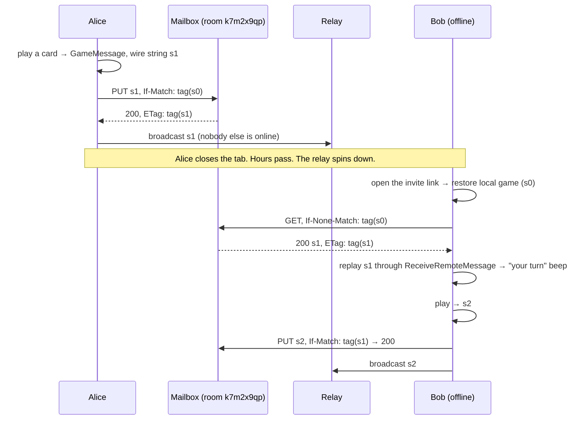

# Asynchronous Play Design Proposal

- **Date:** 2026-11-03
- **Status:** Proposed. Not implemented. The iterations are tracked in
  [`issues/open/2026-11-03-async-play.md`](../issues/open/2026-11-03-async-play.md).
- **Issue:** [#22 Async Play](https://github.com/bagrounds/domination/issues/22)
- **Builds on:** [Matchmaking design](./2026-10-31-matchmaking-design.md) (rooms, the `dom/1` header, room-scoped storage)

## 1. Summary

Today a move only reaches the players who are connected when it is made. The relay
forwards each message once and remembers nothing, so a player who is offline misses the
move for good. Someone has to press *Load Game* later to push the state around again.

Every system that delivers to people who are not online at the same time has the same
three parts:

1. **Something that stays online and keeps the data** (store and forward).
2. **A way to catch up when you come back** (pull on wake).
3. **A rule for two writes that start from the same state** (conflict handling).

Domination needs very little of each, because every `GameMessage` already carries the
**whole** game state. The relay does not need to keep a log of moves, only the **latest
state of each room**, the way an MQTT broker keeps a *retained message* or a Kafka topic
keeps the latest value per key after *log compaction*.

The proposal:

0. **Iteration 0: make reconnects actually reconnect (client only).** I found a bug while
   researching this design: after the WebSocket reconnects, a client keeps sending on the
   old, closed socket, so all its messages are silently dropped until the page is reloaded
   (§3.3, experiment E2). Fix that and re-announce presence on reconnect.
1. **Iteration 1: a room mailbox (async play).** Add a tiny HTTP service that stores the
   latest game envelope of each game room: `GET` and a conditional `PUT` on
   `/v1/rooms/<code>`. It is content-agnostic: it stores the same compressed string that
   is broadcast, and never decodes it. Host it on a **Cloudflare Worker with one Durable
   Object per room** (free plan, durable, no cold start). Clients write through to it on
   every move and read from it on load, on reconnect, on `online` and when the tab
   becomes visible again. The WebSocket relay on Render does not change.
2. **Later, optional:** a short history of missed plays and chat (§6.5), "it's your turn"
   push notifications (§6.6), and moving the live relay into the same Durable Objects
   (§6.7).

The relay, the wire layout of messages and the global room do not change. Old clients
keep working with new ones.

## 2. Goals and Constraints

| # | Requirement | How this design meets it |
|---|---|---|
| R1 | A move reaches a player who was offline when it was made, as soon as they come back | Every move is written to the room mailbox. Clients read it on load and on every wake-up (§6.4.3) |
| R2 | No manual "push the state around" after a missed message | Reconnects really reconnect (§6.3). Pulls on wake replace manual *Load Game* |
| R3 | Simplest and free (README principle *Zero cost infrastructure*) | One HTTP endpoint with two methods, about 60 lines of Worker code, on Cloudflare's free plan (§8). No change to the relay |
| R4 | Robust | Durable storage (§5). Compare-and-set writes, so a stale client cannot overwrite a newer move (§6.4.5). Moves made offline wait in an outbox and are sent later (§6.4.4) |
| R5 | Fits the existing system | Rooms from the matchmaking design are the unit of a match. The mailbox stores the same envelope the relay carries, and replaying it uses the existing receive path (§3.4, M4) |
| R6 | Smooth evolution | Additive, Parallel Change (§7). The relay is unchanged. Old and new clients keep playing together live |
| R7 | Domain-driven, functional and testable | Pure `Domination.Data.Mailbox` module for every decision, effects behind a `Mailbox` capability (§6.4.6), property tests (§10) |

Non-goals: accounts, private or encrypted storage (§9.1), server-side validation of
moves, time controls, and async play in the **global room** (it is being retired, see
[`issues/open/2026-10-31-matchmaking-retire-global-game.md`](../issues/open/2026-10-31-matchmaking-retire-global-game.md)).

## 3. How It Works Today

### 3.1 The parts that matter here

- **Relay.** `server/index.js` (27 lines) forwards each message to every other open socket.
  It stores nothing. It runs on Render's free plan (`render.yaml`).
- **Transport.** `src/FFI/WebSocket.js` keeps one socket per window in
  `window._singletonWebSocket`. On an unexpected close it reconnects after 5 s and makes
  the new socket the singleton. `alert()` is called on every socket error.
- **Game sync.** Every play broadcasts a `GameMessage { i, state, playMade }` that carries
  the **whole** game state. On receipt, `ReceiveGame` adopts the state, keeps the
  local seat and saves it. It logs the expected `i` but accepts any `i`, because *Undo*
  legitimately goes back (`src/UI/Domination.purs`).
- **Rooms.** A game room is chosen by `#room=<code>`. Clients drop messages for other rooms
  by reading the `dom/1/<room>/<sender>` header first (matchmaking design §5).
- **Startup.** A member of a game room restores its saved game locally and does **not**
  broadcast it, so a stale member cannot roll the room back (`sharesSavedGameOnStartup`
  in `src/Main.purs`). Nobody sends the current game to a member who joins late, which is
  tracked in [`issues/open/2026-10-31-matchmaking-catch-up-on-join.md`](../issues/open/2026-10-31-matchmaking-catch-up-on-join.md).

### 3.2 Hosting facts

| Fact | Source |
|---|---|
| A free Render web service spins down after 15 minutes without inbound HTTP requests or WebSocket messages. It takes about a minute to spin back up | [Render: Deploy for Free](https://render.com/docs/free) |
| A free Render service has an ephemeral filesystem, so local files are lost on every redeploy, restart or spin-down. Free web services cannot attach a persistent disk | same |
| Free Render Postgres databases expire 30 days after creation. A free Render Key Value instance is in memory only and "might restart at any time (thereby deleting its data)" | same |

So the relay cannot keep anything for an absent player. While anyone is connected,
heartbeats (every 5 s) keep it awake. Fifteen minutes after the last player leaves,
everything in its memory is gone.

### 3.3 Verified: what goes wrong today

I bundled the app, ran the local relay and drove two browsers with Playwright: Chrome with
two separate profiles, *A* and *B*, in room `async1`. The scripts were throwaway and are
not committed.

| # | Experiment | Result |
|---|---|---|
| E1 | A and B online; A sends a chat message | B receives it |
| E2 | Restart the relay. Wait 7 s, then A and B each send a chat message | The singleton socket in both tabs reconnected (`readyState` 1), but **neither message arrived**. Every `send` went to the **old** socket (`readyState` 3), and Chrome logged `WebSocket is already in CLOSING or CLOSED state.` |
| E3 | B closes its tab. A starts a game. B opens the room again | A few seconds later, B still has no game. Nothing will ever send it one unless A makes another move or presses *Load Game* |

**Why E2 happens.** `Initialize` stores the socket from the first `onopen` in
`AppState.maybeBroadcaster`. On reconnect, the FFI calls the same `makeAff` callback
again. `Aff` ignores a second resume (its `runTick` guard), so the state keeps the dead
socket. Incoming messages still arrive, because the new socket's `onmessage` dispatches to
`#remote-message-target`. Outgoing messages go to the dead one. The WebSocket standard
says that `send` on a closed socket does not throw; the data is simply discarded
([WHATWG WebSockets, `send()`](https://websockets.spec.whatwg.org/#dom-websocket-send)).
A Render restart, deploy or network blip therefore leaves every connected player able to
read but not write, with no visible error. This matches the symptom in the issue: "If a
message is missed for any reason, we have to reconnect and manually push the state around."

### 3.4 Verified: sizes and a mailbox prototype

**Message sizes.** I wrote a throwaway PureScript program that plays games with the built-in
bots and encodes every `GameMessage` with a `dom/1` header, using the real `writeWire`
(lz-string `compressToUTF16`). Sizes are the UTF-8 bytes sent on the wire. Each row
gives the range over four or five runs.

| Game | Plays | First message | Largest message | All messages |
|---|---|---|---|---|
| 2 players, BigMoney, short | 31–53 | 362–376 B | 720–772 B | 21–37 KB |
| 2 players, BigMoney, long | 108–124 (two runs hit the cap) | 360–378 B | 916–1,024 B | 84–98 KB |
| 4 players, Random, long | 1,018–1,778 | 405–411 B | 2,074–2,866 B | 1.3–2.5 MB |
| 6 players, Random, long | 1,616–2,553 | 435–442 B | 3,034–3,402 B | 2.5–4.6 MB |

The Random-bot runs ended early, when a bot found no legal play. Some BigMoney runs never
ended and stopped at a 3,000-play cap. Neither affects the conclusion. The **latest** state
of a room is at most about 3.4 KB, while the whole history of a long game is megabytes.
Keeping only the latest state is about a thousand times cheaper than keeping a log, and it
is enough to resume the game.

**Mailbox prototype.** I wrote a 43-line Node HTTP server in `/tmp` with the API in §6.4.1
(conditional `PUT`, SHA-256 `ETag`, CORS). I ran it on a different origin from the
pages and drove it from the same two browser profiles:

| # | Experiment | Result |
|---|---|---|
| M1 | B offline. A starts a game | A has the game at `i = 0` |
| M2 | A `PUT`s the exact string it broadcast, with `If-None-Match: *`, cross-origin | `201`. The `ETag` header is readable (CORS `Access-Control-Expose-Headers`), and it equals a SHA-256 computed in the page with `crypto.subtle` |
| M3 | A closes its tab. B opens the room | B has no game |
| M4 | B `GET`s the mailbox and dispatches the body as a `CustomEvent` on `#remote-message-target`, which is what the WebSocket FFI does | B adopts the game through the **existing** receive path (header check, decode, `ReceiveGame`, save). B's saved state equals A's |
| M5 | `PUT` with a stale `If-Match`, then with the current one, then with that same one again | `412` with the current body, then `200`, then `412` |

M4 matters most: reading from the mailbox needs **no new decoding path and no new message
type**. The mailbox is just another way to receive the same envelope.

## 4. Research: Who Has Solved This?

| Source | What we take from it |
|---|---|
| Email: [RFC 5321 SMTP](https://www.rfc-editor.org/rfc/rfc5321) §4.5.4 (retry strategies) | The original **store and forward** system. A server that stays online takes custody of the message and retries until the receiver can take it. The sender's outbox retries too. We copy both: the mailbox keeps the move, and the client keeps an outbox (§6.4.4) |
| [RFC 4838](https://www.rfc-editor.org/rfc/rfc4838), *Delay-Tolerant Networking Architecture* | Networks where the two ends are rarely connected at the same time. Nodes keep messages in **persistent storage** until they can be passed on. The general principle: when the ends do not overlap, something in between must hold the data, and memory that a restart erases is not enough |
| XMPP [XEP-0160 Offline Messages](https://xmpp.org/extensions/xep-0160.html) and [XEP-0313 Message Archive Management](https://xmpp.org/extensions/xep-0313.html) | Chat servers keep messages for offline users and deliver them on the next login. Later, clients query the archive for "everything after the last message I saw". That is the model for the optional history in §6.5 |
| [Matrix client-server API, syncing](https://spec.matrix.org/latest/client-server-api/#syncing) | A client calls `/sync` with the `since` token from its last sync and gets everything it missed. **Pull on wake with a cursor**. Our cursor is the `ETag` of the state we already have (§6.4.3) |
| [MQTT 5.0](https://docs.oasis-open.org/mqtt/mqtt/v5.0/mqtt-v5.0.html) §3.3.1.3, *Retain* | A broker keeps the **last retained message per topic** and sends it to every new subscriber. That is exactly our mailbox: one topic per room, last value wins. MQTT also shows the trap: a retained value has no version, so a stale publisher silently replaces a newer value. We add a version, the `ETag` |
| Apache Kafka, [log compaction](https://kafka.apache.org/documentation/#compaction) | "Retain at least the last known value for each message key." When each message is a full state, history can be thrown away. Our `GameMessage` is a full state (§3.1) |
| Apple GameKit, [`GKTurnBasedMatch`](https://developer.apple.com/documentation/gamekit/gkturnbasedmatch) and [sending messages in turn-based games](https://developer.apple.com/documentation/gamekit/sending-messages-to-players-in-turn-based-games) | The best-known async game API. Game Center stores one opaque, size-limited `matchData` blob per match. The current player saves it with `saveCurrentTurn` or `endTurn`, and the others load it when they open the game or get a turn notification. The server never reads the blob. Our mailbox is the same design: an opaque latest-state blob per room |
| Google Play Games Services, [end of the multiplayer APIs](https://support.google.com/googleplay/android-developer/answer/9469745) | Google shut down its hosted turn-based multiplayer API on March 31, 2020 and pointed developers to Firebase. A vendor's game service can disappear. We keep the protocol tiny and portable, so the mailbox can move to any host (§6.4.7) |
| [Play-by-email games](https://en.wikipedia.org/wiki/Play-by-mail_game) and correspondence chess | Turn-based games have been played asynchronously for a long time by mailing the position or the save file. Because our state is at most about 3.4 KB, a "turn link" is a zero-infrastructure fallback (option B, §5) |
| [RFC 9110](https://www.rfc-editor.org/rfc/rfc9110) §8.8.3 `ETag`, §13.1.1 `If-Match`; [RFC 6585](https://www.rfc-editor.org/rfc/rfc6585) §3, *428 Precondition Required* | The standard HTTP answer to the **lost update** problem. A client writes "only if the current version is still the one I read". A server can require such conditions with `428`. A content hash is a valid strong `ETag` |
| Shapiro et al., [*A comprehensive study of Convergent and Commutative Replicated Data Types*](https://inria.hal.science/inria-00555588) (INRIA RR-7506, 2011) | The difference between **state-based** replication (send the whole state, keep the latest) and **operation-based** replication (send each operation, deliver all of them exactly once, in order). We are state-based, which is why one stored value is enough. Our state has no merge function, so concurrent writes need compare-and-set rather than a merge (§6.4.5) |
| Demers et al., *Epidemic Algorithms for Replicated Database Maintenance* (PODC 1987) | **Anti-entropy:** peers compare state and the newer one wins. Catch-up on join is anti-entropy between peers. It only works when a peer that has the latest state is online at the same time, so it cannot deliver async play by itself (option A) |
| Kleppmann et al., [*Local-First Software*](https://www.inkandswitch.com/local-first/) (Onward! 2019) | The app keeps working offline with its local copy. A server is just a peer that is always online and helps others sync. Domination already keeps the game in `localStorage`. The mailbox is that always-online peer, and it never decides the game |
| Cloudflare, [Durable Objects](https://developers.cloudflare.com/durable-objects/) with [WebSockets](https://developers.cloudflare.com/durable-objects/best-practices/websockets/), [limits](https://developers.cloudflare.com/durable-objects/platform/limits/) and [pricing](https://developers.cloudflare.com/durable-objects/platform/pricing/); [Cloudflare acquires PartyKit](https://blog.cloudflare.com/cloudflare-acquires-partykit/) | A Durable Object is a single-threaded object with its own durable SQLite storage, addressed by name. **One object per room** is the standard design for multiplayer rooms (PartyKit is built on it). Single-threading makes compare-and-set trivial. SQLite-backed objects are on the free plan |
| AWS Architecture Blog, [Exponential Backoff and Jitter](https://aws.amazon.com/blogs/architecture/exponential-backoff-and-jitter/) | When a shared server restarts, every client reconnects at once. Random, growing delays spread them out. This applies to iteration 0 |
| Web Push: [RFC 8030](https://www.rfc-editor.org/rfc/rfc8030), [RFC 8291](https://www.rfc-editor.org/rfc/rfc8291) §4; WebKit, [Web Push for Web Apps on iOS and iPadOS](https://webkit.org/blog/13878/web-push-for-web-apps-on-ios-and-ipados/) | Push can wake a closed PWA, but a push service only has to accept 4,096 bytes, which leaves at most 3,993 bytes of plaintext. iOS supports it only for web apps added to the Home Screen. It is a good **notification** channel ("your turn") but not storage (§6.6) |
| MDN: [`visibilitychange`](https://developer.mozilla.org/en-US/docs/Web/API/Document/visibilitychange_event), [`online`](https://developer.mozilla.org/en-US/docs/Web/API/Window/online_event) | Mobile browsers freeze background tabs and their sockets die quietly. Coming back to the tab or back online is the right time to pull |

**Lessons:**

1. **Async delivery needs durable custody.** If the two players are never online at the
   same time, only a third party that stays online can carry the move (SMTP, DTN). Peer-only
   designs (anti-entropy) help but cannot be enough on their own.
2. **Full-state messages make the third party tiny.** Keep the latest state per room (MQTT
   retain, Kafka compaction, Game Center `matchData`), not a queue per player (XMPP).
3. **Make the store content-agnostic** (Game Center's opaque blob, and the end-to-end
   argument from the matchmaking design). The store never needs to understand the game,
   so it never has to change when the game changes.
4. **Version every write** (HTTP `ETag` / `If-Match`). Retained values without versions
   are how stale data overwrites fresh data.
5. **Pull when you wake up, with a cursor** (Matrix `since`, conditional `GET`).
6. **Keep the protocol portable.** Hosted game services get shut down (Google Play Games).

## 5. Options

| | Option | Delivers when the two players never overlap? | Survives relay restarts? | Cost | New account or vendor | Size of change |
|---|---|---|---|---|---|---|
| A | **Peers only.** Catch-up on join and on reconnect: a member that has the game resends it | ❌ Needs someone with the latest state to be online at the same time | ✅ (no server state) | Free | None | Small, client only |
| B | **Turn links (play by email).** *Copy turn link* puts the compressed state in a URL fragment; send it in any messenger | ✅ Manual | ✅ | Free | None | Small, client only. A link of a few KB |
| C | **Retained message in the relay's memory.** The relay keeps the last game frame per room and sends it to new connections | ⚠️ Only if the other player connects before the relay spins down (15 min after the last player leaves) | ❌ Spin-down, deploys and restarts erase it | Free | None | Small relay change plus a way to mark retained frames |
| D | **Render relay plus an external free database** (for example Upstash Redis) | ✅ | ✅ | Free, but [Upstash's free plan](https://upstash.com/docs/redis/overall/billing) allows 500K commands a month and archives databases after 30 days without use | Upstash, plus a secret in Render | Medium. The relay still has a one-minute cold start |
| **E** | **Room mailbox on a Cloudflare Worker + Durable Object** (recommended) | ✅ | ✅ (independent of the relay) | Free: 100,000 writes and requests a day (§8) | Cloudflare (free) | ~60 lines of Worker code, plus a client capability. **Relay unchanged** |
| F | **Move the whole relay to Durable Objects** (one object per room for live messages and storage) | ✅ | ✅ | Free | Cloudflare | Relay rewrite. Old builds (still on Render) and new builds would no longer meet until old builds are gone |
| G | **Firebase Realtime Database** as transport and store | ✅ | ✅ | Free [Spark plan: 100 simultaneous connections](https://firebase.google.com/docs/database/usage/limits) | Google | Replace the transport and add a large SDK. Breaks old clients |
| H | **Public third-party relays** (Nostr relays, public MQTT test brokers) | ⚠️ Depends on each operator's retention | ⚠️ | Free | Many, with no guarantees | Medium. Everything is public |
| I | **Web Push** | Not storage: notification only, at most 3,993 bytes | n/a | Free | Browser push services | A complement, not an alternative (§6.6) |

**Why E.** It is the smallest change that actually meets R1 and R4. The free Render host
cannot keep state (§3.2), so options C and D either lose data or add a second vendor
to a relay that still takes a minute to wake up. Option E leaves the relay alone, so live
play and old clients are not affected. It uses the same pattern as Game Center and
PartyKit, and it fits easily in the free plan. F, G and H are larger, add vendors without guarantees, or
break compatibility.

**What about A and B?** Both are still worth having. A is iteration 0's natural partner:
once reconnects work, catch-up on join heals missed messages between peers who are online
together, even if the mailbox is unreachable. B is a zero-infrastructure fallback and fits
the open
[save/load controls issue](../issues/open/2026-03-11-save-load-controls.md). Neither is
needed for async play itself.

## 6. Recommended Design

### 6.1 Overview




### 6.2 Domain language

| Term | Meaning |
|---|---|
| **Mailbox** | The durable store that keeps the latest game envelope of one game room |
| **Envelope** | The exact compressed wire string a client broadcasts (`writeWire (Tuple header GameWireMessage)`). The mailbox stores it unchanged |
| **Tag** | The `ETag` of an envelope: `"` + base64url(SHA-256(UTF-8 bytes)) + `"`. The same function runs in the Worker and the browser (M2) |
| **Base** | The tag of the envelope a client's current game came from: the last one it received or sent |
| **Seen tags** | A bounded list of the last 32 tags this client has adopted or written in a room |
| **Pull** | `GET` the mailbox and replay a newer envelope through the normal receive path |
| **Write-through** | On every own game change in a game room: conditional `PUT`, then broadcast |
| **Outbox** | At most **one** pending write per room. Because messages are full states, a newer pending write replaces an older one |
| **Fast-forward** | The mailbox is behind but holds a state this client has already seen, so writing over it loses nothing |
| **Conflict** | The mailbox holds a state this client has never seen. Someone else moved first |

### 6.3 Iteration 0: reconnect that really reconnects (client only)

This fixes the bug in E2. It also helps live play without async play.

1. **Send on the current socket.** `send` in `src/FFI/WebSocket.js` should use
   `getWebSocket()` instead of the socket captured by the first `onopen`.
   - While the socket is `CONNECTING` or closed, put the message in a small queue in the
     FFI. `send` throws `InvalidStateError` while `CONNECTING`.
   - Flush the queue on `onopen`. Keep chat and game messages and drop presence messages,
     because a fresh `Join` replaces them.
   - The broadcaster then stands for the connection, not for one socket.
2. **Announce reconnects.** After a *re*connect, dispatch a `reconnected` event on
   `#remote-message-target`. `Main` subscribes with a new `Reconnected` action. It
   sends `JoinMessage` and `UsernameMessage` (peers have pruned us after 15 s), then
   pulls the mailbox (iteration 1) or does catch-up on join.
3. **Back off with jitter.** Replace the fixed 5 s retry with a random delay that grows to
   about a minute, so that a Render restart does not bring every client back at the same
   instant.
4. **No `alert()` storms.** The reconnect loop to an unreachable server shows an alert
   every 5 s (I saw this in testing). Log the error and show a small *offline* state next
   to the connection count instead.

### 6.4 Iteration 1: the room mailbox

#### 6.4.1 HTTP API

```text
GET  /v1/rooms/{room-code}
     If-None-Match: <tag>        (optional)
  -> 200 <envelope>  ETag: <tag>
  -> 304             (the client already has it)
  -> 404             (empty mailbox)

PUT  /v1/rooms/{room-code}       body: <envelope>, at most 16 KiB
     If-Match: <tag>             replace the current envelope
     If-None-Match: *            first write
  -> 200 / 201       ETag: <new tag>
  -> 412 <current envelope>  ETag: <current tag>   (precondition failed)
  -> 413             (too large)
  -> 428             (no precondition; every write must be conditional)

OPTIONS ...  -> CORS preflight
```

- `room-code` uses the existing grammar, `[a-z0-9]{1,32}` (`Domination.Data.Room`).
  Anything else returns 404. The global room has no mailbox.
- Responses set `Cache-Control: no-store`. CORS allows the two app origins
  (`https://domination.fun`, `https://bagrounds.github.io`) and `localhost`, allows
  `If-Match` and `If-None-Match`, and exposes `ETag` (M2).
- Returning the current envelope with `412` saves a round trip when resolving a conflict
  (M5).
- The 16 KiB limit is almost five times the largest message measured (§3.4).
- The `/v1/` prefix leaves room for history (§6.5) without breaking clients.

#### 6.4.2 Server: one Durable Object per room

```js
// mailbox/src/index.js  (sketch, about 60 lines in total)
export default {
  fetch: (request, env) => {
    const room = roomFromPath(new URL(request.url).pathname)     // /v1/rooms/<code>
    return room === null
      ? withCors(request, new Response(null, { status: request.method === 'OPTIONS' ? 204 : 404 }))
      : env.MAILBOX.get(env.MAILBOX.idFromName(room)).fetch(request)
  }
}

export class Mailbox extends DurableObject {
  async fetch(request) {
    const body = await request.text()                            // read before touching storage
    const current = await this.ctx.storage.get('latest')         // { envelope, tag } | undefined
    const decision = decide(request.method, preconditionOf(request.headers), current, body, await tagOf(body))
    if (decision.store) {
      await this.ctx.storage.put('latest', decision.store)
      await this.ctx.storage.setAlarm(Date.now() + ninetyDays)   // expire idle rooms
    }
    return withCors(request, toResponse(decision))
  }
  async alarm() { await this.ctx.storage.deleteAll() }
}
```

- **`decide` is a pure function** (`mailbox/src/decide.js`): method × precondition ×
  current × body → response and maybe a new value. It is tested with property tests in
  Node (§10). The Durable Object is only the imperative shell.
- **Compare-and-set is atomic.** A Durable Object runs one piece of code at a time, and
  its input gates hold back other requests while it waits on its own storage. The sketch
  reads the body and hashes it before the `get`, so nothing but storage happens between
  `get` and `put`. Awaiting the body in between would let another request run there.
- **Storage:** one row per room, at most about 3.4 KB. Idle rooms are deleted after 90
  days by a Durable Object alarm.
- **Deployment:** `mailbox/wrangler.toml` with a SQLite-backed Durable Object class
  (`new_sqlite_classes`, required on the free plan). Deploy with `npx wrangler deploy`,
  by hand or from a GitHub Action that runs only on `master` using a
  `CLOUDFLARE_API_TOKEN` secret. `npx wrangler dev` runs the same code locally with local
  storage for manual and end-to-end tests.

#### 6.4.3 Client: read path (pull)

Pull when there may be news:

| Trigger | Why |
|---|---|
| `Initialize` in a game room, after `restoreGame` | Coming back after being away (E3) |
| `Reconnected` (iteration 0) | Anything broadcast while we were disconnected was lost |
| `window` `online` | Back from a network outage |
| `document` `visibilitychange` to visible | Mobile tabs are frozen in the background and their sockets die quietly |

A pull first delivers a pending outbox write, if there is one (§6.4.4). Its `412` path
already adopts anything newer, so a pull never silently discards a move made offline.
Otherwise a pull is `GET` with `If-None-Match: base`:

- **304 or 404:** nothing to do. On 404 with a local game, seed the mailbox with
  `If-None-Match: *`, so a room whose mailbox expired can recover from any member.
- **200:** replay the body through the existing receive path (M4). That means header
  admission, decode and `ReceiveGame`, which saves it and beeps if it is your turn. Add a
  chat line: *(caught up: the game changed while you were away)*. Set `base` to the new
  tag and add it to the seen tags.

#### 6.4.4 Client: write path (write-through and outbox)

On every **own** game change in a game room (a play, a bot play hosted here, *Start*,
*Undo*, *Load Game*):

1. Encode the envelope once, as today in `sendMessage`.
2. Put `{ envelope, base }` in the room's **outbox**, replacing anything already there,
   and persist it under `scopedKey room "mailbox_outbox"`. A move made offline survives a
   reload.
3. `PUT` with `If-Match: base`, or `If-None-Match: *` if there is no base.
   - **2xx:** clear the outbox, set `base` to the returned tag, and broadcast the envelope.
   - **412:** resolve (§6.4.5).
   - **Network error, 5xx, quota exhausted or more than 3 s without a reply:** broadcast
     anyway, so live play never waits on the mailbox. Leave the write in the outbox and
     retry on the next pull trigger (§6.4.3).
4. Received `GameMessage`s (from the relay or a pull) set `base` to the tag of the received
   string. The tag is computed from the raw `detail` in `ReceiveRemoteMessage`.
5. Every tag that is received or accepted is added to the seen tags. `base` and the seen
   tags are persisted next to the outbox (`scopedKey room "mailbox_base"` and
   `"mailbox_seen"`).

`base` only moves when the mailbox accepts a write or a game arrives from someone else. A
chain of moves made offline therefore still carries the last base the mailbox knew, and
the newest move in the outbox is accepted directly when the player is back online.

Chat, presence and username messages do not go to the mailbox.

#### 6.4.5 Conflicts: fast-forward or adopt

A `412` comes with the mailbox's current envelope `m`:

```purescript
data Resolution
  = FastForward Tag                        -- retry the PUT with If-Match: tag m
  | Adopt { envelope :: String, tag :: Tag }

resolve :: SeenTags -> { envelope :: String, tag :: Tag } -> Resolution
resolve seen current
  | current.tag `elem` seen = FastForward current.tag
  | otherwise               = Adopt current
```

- **Fast-forward.** We have already seen `m`, so our state comes after it. The mailbox is
  behind because we received a later state over the relay that never reached the mailbox:
  - a move by a peer whose `PUT` failed, or
  - a move by a peer on a build without the mailbox.

  Retry with `If-Match: tag m`. This is git's fast-forward check. If the retry gets
  another `412`, resolve again. Each round needs a new write by someone else, so this ends.
- **Adopt.** `m` is new to us, so someone else moved first from a state we also had. Our
  write loses:
  - Replay `m` through the receive path.
  - Broadcast `m`, so that any live peer who saw our move during an outage converges
    again.
  - Clear the outbox and add a chat line: *(another move arrived first; yours was not
    applied)*.

  This is what HTTP's lost-update rule and Game Center's single current player give.
  First writer wins. Nobody's state is silently overwritten.
- Tags are content hashes, so a state that comes back with exactly the same content (the
  ABA problem) is harmless: the same content means the same game.
- The seen tags are limited to 32 entries.

Turn-based play makes conflicts rare. They need a stale or offline client to act. Today
such a client silently rolls everyone back. With the mailbox, the stale write is refused.

#### 6.4.6 Client modules

| Module | Contents |
|---|---|
| `src/Data/Mailbox.purs` (new, pure) | `Tag`, `SeenTags` (bounded, newest first), `Outbox`, `Precondition = IfMatch Tag \| IfNoneMatchAny`, `preconditionFor :: Maybe Tag -> Precondition`, `Delivery = Accepted Tag \| Rejected { envelope, tag } \| Unreachable String`, `resolve`, `nextOutbox`, `mailboxUrl :: String -> RoomCode -> String` |
| `src/Capability/Mailbox.purs` (new) | `class Monad m <= Mailbox m` with `pull :: String -> Maybe Tag -> m (Either String (Maybe { envelope :: String, tag :: Tag }))`, `deliver :: String -> Precondition -> String -> m Delivery` and `tagOf :: String -> m Tag`. Instances for `AppM` and `HalogenM`, using `fetch` and `crypto.subtle.digest` through a small FFI, like `Dom`, `Storage` and `WireCodec` |
| `src/FFI/WebSocket.js` | Iteration 0 changes (§6.3) |
| `src/Main.purs` | `Pull` and `Reconnected` actions; subscriptions to `online` and `visibilitychange`; `publishGame` (outbox → `deliver` → broadcast) used by `HandleGameEvent` and `shareGame`; `base` updated in `ReceiveRemoteMessage` |
| `src/AppState.purs` | `mailboxUrl :: String` (default constant, like `defaultServerUrl`), `mailboxStatus :: Synced \| Pending \| Offline` |
| `src/UI/Settings.purs` | Connection tab: a *Mailbox URL* input next to *Server URL*. An empty value turns async play off |
| `src/Main.purs` render | A small cloud mark next to the connection count: ✓ synced, … pending, ✗ offline |
| `mailbox/` (new) | Worker, Durable Object, pure `decide.js`, tests, `wrangler.toml` |

There are no changes to `Message.WireMessage`, `WireEnvelope`, the header grammar or the
relay.

#### 6.4.7 Portability

The API is two HTTP methods with standard headers, and the stored value is an opaque
string. Any host that can do compare-and-set per key can serve it: a Durable Object
today, or a Node process with a database, or a Deno or Bun server with SQLite tomorrow.
The client only knows a URL, which the Connection tab can change, like the server URL.

### 6.5 Later: what happened while I was away (history and async chat)

The mailbox gives the latest state, but the game log only shows the last play. To show
*"Player 1 played Smithy, bought Gold"* and chat sent while you were away, the Durable
Object can also keep a **bounded history**:

- the last 200 envelopes with a server sequence number,
- read with `GET /v1/rooms/{code}/history?after=<seq>`, like Matrix `since` and XEP-0313.

Game envelopes would be replayed in order. Chat would also need its own write-through.
The 200 envelopes take at most about 700 KB per active room, and idle rooms expire.

### 6.6 Later: "it's your turn" notifications

A Durable Object can send Web Push messages. It would:

- store push subscriptions per room member,
- sign with a VAPID key held as a Worker secret,
- send a tiny payload such as `{ room, turn }`. The state stays in the mailbox and is
  read when the app opens.

The service worker would show the notification and open `#room=<code>` when it is
clicked. Notifications would be opt-in, per room. iOS supports them only for Home Screen
web apps. Until then, players can keep the tab open and get the existing *your turn* beep,
or check back.

### 6.7 Later: move the live relay into the room objects

The same Durable Object could accept the room's WebSockets (with the hibernation API) and
broadcast. That gives per-room routing (matchmaking §6.4), removes Render's one-minute
cold start, and puts everything with one vendor. It splits old and new builds onto
different relays, so it should wait until old builds are rare (see
[`issues/open/2026-03-11-service-worker-fast-updates.md`](../issues/open/2026-03-11-service-worker-fast-updates.md)).
Heartbeats would count against the free request quota at 20 incoming messages per
request. Today every heartbeat makes every peer send a `UsernameMessage` back, which would
be worth trimming first.

## 7. Compatibility and Rollout

| Sender ↓ / Receiver → | Old build (no mailbox) | New build |
|---|---|---|
| Old build | Live, as today | Live, as today. The new build updates `base` from the received string. The mailbox is behind until a new build writes, and fast-forward handles that (§6.4.5) |
| New build | Live, as today (the envelope is unchanged) | Live and async |

- **Live play is unchanged** for every pair of builds: same relay, same envelope.
- **Async play needs the moving player to be on a new build.** A move by an old build
  reaches the mailbox only when a new build makes the next move.
- **The global room** keeps today's behaviour. It has no mailbox.

**Rollout (Parallel Change):**

1. **Iteration 0.** Ship the reconnect fix with a patch version bump. It is independent.
2. **Expand.** Deploy the Worker. No client uses it yet. Check it with `curl`.
3. **Migrate.** Ship the client with a minor version bump (`src/Version.purs` and
   `CACHE_NAME` in `assets/sw.js`), first to the GitHub preview, then to `domination.fun`.
4. **Rollback** is safe at any point. Clients without a mailbox URL behave exactly like
   today. The stored envelopes are ignored and expire on their own.

The service worker does not interfere. Its `fetch` handler forwards every request it has
not cached, headers included, and it only caches cross-origin responses of type `basic`.
Mailbox responses are CORS responses (type `cors`), so they are never cached, and the
mailbox also sends `Cache-Control: no-store`. When the network fails, the handler's
`catch` turns the request into a network error, which the client treats as *unreachable*.

## 8. Free-Tier Budget

Cloudflare Workers Free ([Workers limits](https://developers.cloudflare.com/workers/platform/limits/),
[Durable Objects pricing](https://developers.cloudflare.com/durable-objects/platform/pricing/)):

| Limit (per day unless noted) | Free plan | Mailbox use |
|---|---|---|
| Worker requests | 100,000 | One per `GET` or `PUT` |
| Durable Object requests | 100,000 | Same |
| Rows written | 100,000 | One per accepted `PUT` (one per play) |
| Rows read | 5,000,000 | One per request |
| Stored data | 5 GB total | At most about 3.4 KB per room |
| CPU per request | 10 ms | SHA-256 of 3.4 KB is far below that |

From §3.4, one game is about 30 to 2,500 plays. So 100,000 writes a day is roughly 40 of
the longest bot games or about 2,000 short two-player games every day, far above today's
traffic. Pulls happen once per wake-up, not per play. If a quota runs out, Cloudflare returns errors
until 00:00 UTC. The client treats that as *unreachable* (§6.4.4), so play falls back to
today's live-only behaviour rather than breaking.

The Render relay is unchanged and stays inside its 750 free hours a month.

## 9. Risks and Mitigations

### 9.1 Stored state is not private

For the first time, game state is stored on a server. Anyone who knows a room code can
read or overwrite that room's mailbox, just as anyone can already read or send to any
room through the relay (matchmaking design §9.1). The mailbox stores only the game
envelope (no chat in iteration 1). Rooms expire after 90 days without a write. The room
panel's notice can mention that a private game's latest state is kept online so friends
can play at their own pace.

### 9.2 Other risks

| Risk | Mitigation |
|---|---|
| A stale or offline client overwrites a newer move | Conditional writes. Unseen states are adopted, never overwritten (§6.4.5) |
| A move made offline is lost on reload | Persisted single-slot outbox (§6.4.4) |
| The mailbox is down or out of quota | Writes fall back to live broadcast and stay queued. Reads simply find nothing new. This is never worse than today |
| Two clients host the same bot seat | They write conflicting plays. The second is refused and adopts the first |
| Abuse: huge or numerous writes | 16 KiB limit, room-code grammar, CORS to app origins, 90-day expiry, and a 5 GB free cap that fails closed (errors, no bill). Rate limits can be added in the Durable Object if needed |
| Two vendors (Render for live, Cloudflare for async) | The API is portable (§6.4.7). §6.7 can consolidate later |
| `crypto.subtle` needs a secure context | Both app origins use HTTPS. `localhost` counts as secure for development |
| Cloudflare account and deploy token | One free account. The token is a GitHub Actions secret, never in the repository. Deploying by hand with `wrangler` also works |
| Undo by one player while another is offline | Undo is a normal write. It is shared like a move, and conflicts resolve the same way |

## 10. Test Plan

**Pure client logic (QuickCheck, a new "Mailbox" section like `test/Room.purs`):**

1. `resolve` returns `FastForward` exactly when the current tag is in the seen tags.
2. Seen tags never exceed 32 entries, and the newest entry is always kept.
3. The outbox keeps only the newest write. Any sequence of offline writes leaves the last
   one.
4. `preconditionFor Nothing == IfNoneMatchAny` and `preconditionFor (Just t) == IfMatch t`.
5. `mailboxUrl` only builds `/v1/rooms/<code>` from valid room codes.

**Pure server logic (`node --test` in `mailbox/`):**

6. `decide` never stores a value unless the precondition holds, and it never accepts
   a `PUT` without a precondition (428).
7. Sequential model test: for random sequences of `GET` and `PUT` with random
   preconditions, `decide` behaves like a compare-and-set register: every accepted write
   was based on the previous value.
8. The tag is the base64url SHA-256 of the body and matches the browser's `crypto.subtle`
   result (M2).
9. Bodies over 16 KiB return 413, and invalid room codes return 404.

**Browser scenarios** (manual first, then the suite in
[`issues/open/2026-10-31-e2e-browser-tests.md`](../issues/open/2026-10-31-e2e-browser-tests.md)),
using the local relay and `wrangler dev`:

10. E2 again: after a relay restart, chat and moves flow in both directions without a
    reload, and peers' connection counts recover.
11. E3 again: B offline, A plays several moves and closes the tab, B opens the room and
    sees the latest state with A gone and the relay restarted.
12. A goes offline (DevTools offline), plays, reloads, comes back online: the move is
    delivered from the outbox.
13. A and B both act from the same state while B is offline: B's write is refused, B
    adopts A's state, and both end up with the same state.
14. A mixed room with an old build: live play works both ways, and async play resumes
    after the next move by a new build.

## 11. Open Questions

1. Is a Cloudflare account acceptable as a second free vendor? If not, option D (Render
   plus a free database) is the fallback. The client side would be identical.
2. Should async play also apply to the global room while it still exists? This design
   says no, to avoid storing a state that everyone can overwrite.
3. How long should idle rooms be kept? This design proposes 90 days.
4. Should iteration 0 also add catch-up on join (option A) right away? It is small, and
   it covers the case where the mailbox cannot be reached.
