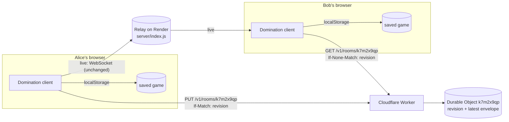
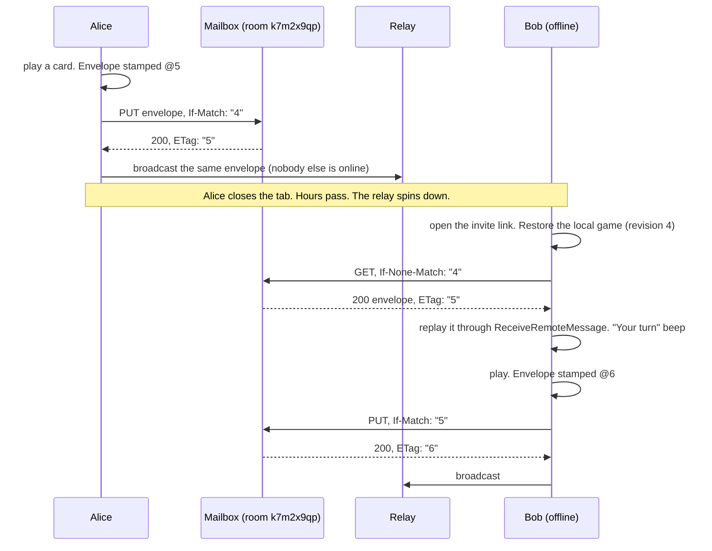

# Asynchronous Play Design Proposal

- **Date:** 2026-11-03
- **Status:** Iterations 0 and 1 are implemented: reconnect (§6.3) and the room mailbox
  (§6.4), live at `https://domination-mailbox.bagrounds.workers.dev`. Since v0.40.0, games
  without a mailbox are versioned (§6.4.10). Sections 6.5–6.7
  are not started. The iterations are tracked in
  [`issues/open/2026-11-03-async-play.md`](../issues/open/2026-11-03-async-play.md).
- **Issue:** [#22 Async Play](https://github.com/bagrounds/domination/issues/22)
- **Builds on:** [Matchmaking design](./2026-10-31-matchmaking-design.md) (rooms, the `dom/1` header, room-scoped storage)

## 1. Summary

Today a move only reaches the players who are connected when it is made. The relay
forwards each message once and remembers nothing, so a player who is offline misses the
move for good. Someone has to press *Load Game* later to push the state around again.

Every system that delivers to people who are not online at the same time has the same
three parts:

1. **Something that stays online and keeps the data** (store and forward).
2. **A way to catch up when you come back** (pull on wake).
3. **A rule for two writes that start from the same state** (conflict handling).

Domination needs very little of each, because every `GameMessage` already carries the
**whole** game state. The relay does not need to keep a log of moves, only the **latest
state of each room**, the way an MQTT broker keeps a *retained message* or a Kafka topic
keeps the latest value per key after *log compaction*.

The proposal:

0. **Iteration 0: make reconnects actually reconnect (client only).** I found a bug while
   researching this design: after the WebSocket reconnects, a client keeps sending on the
   old, closed socket, so all its messages are silently dropped until the page is reloaded
   (§3.3, experiment E2). Fix that and re-announce presence on reconnect.
1. **Iteration 1: a room mailbox (async play).** Add a tiny HTTP service that stores the
   latest game envelope of each game room: `GET` and a conditional `PUT` on
   `/v1/rooms/<code>`. It is content-agnostic: it stores the same compressed string that
   is broadcast, and never decodes it. Host it on a **Cloudflare Worker with one Durable
   Object per room** (free plan, durable, no cold start). Each accepted write gets the
   next **revision** number. Writes only succeed against the latest revision, and live
   frames carry their revision, so neither a stale client nor a late frame can roll the
   game back. Clients write to the mailbox on every move and read from it on load, on
   reconnect, on `online` and when the tab becomes visible again. The WebSocket relay on
   Render does not change.
2. **Later, optional:** a short history of missed plays and chat (§6.5), "it's your turn"
   push notifications (§6.6), and moving the live relay into the same Durable Objects
   (§6.7).

The relay, the layout of messages and the global room do not change. Old clients keep
working with new ones: the revision rides in the header's sender segment, which old
clients already ignore.

## 2. Goals and Constraints

| # | Requirement | How this design meets it |
|---|---|---|
| R1 | A move reaches a player who was offline when it was made, as soon as they come back | Every move is written to the room mailbox. Clients read it on load and on every wake-up (§6.4.4) |
| R2 | No manual "push the state around" after a missed message | Reconnects really reconnect (§6.3). Pulls on wake replace manual *Load Game* |
| R3 | Simplest and free (README principle *Zero cost infrastructure*) | One HTTP endpoint with two methods, about 60 lines of Worker code, on Cloudflare's free plan (§8). No change to the relay |
| R4 | Robust | Durable storage (§5). Compare-and-set writes on server-assigned revisions, so a stale client cannot overwrite a newer move and a late frame cannot roll anyone back (§6.4.6). Moves made offline are delivered later (§6.4.5) |
| R5 | Fits the existing system | Rooms from the matchmaking design are the unit of a match. The mailbox stores the same envelope the relay carries, and replaying it uses the existing receive path (§3.4, M4) |
| R6 | Smooth evolution | Additive, Parallel Change (§7). The relay is unchanged. Old and new clients keep playing together live |
| R7 | Domain-driven, functional and testable | Pure `Domination.Data.Mailbox` module for every decision, effects behind a `Mailbox` capability (§6.4.7), property tests (§10) |

Non-goals: accounts, private or encrypted storage (§9.1), server-side validation of
moves, time controls, and async play in the **global room** (it is being retired, see
[`issues/open/2026-10-31-matchmaking-retire-global-game.md`](../issues/open/2026-10-31-matchmaking-retire-global-game.md)).

## 3. How It Works Today

### 3.1 The parts that matter here

- **Relay.** `server/index.js` (27 lines) forwards each message to every other open socket.
  It stores nothing. It runs on Render's free plan (`render.yaml`).
- **Transport.** `src/FFI/WebSocket.js` keeps one socket per window in
  `window._singletonWebSocket`. On an unexpected close it reconnects after 5 s and makes
  the new socket the singleton. `alert()` is called on every socket error.
- **Game sync.** Every play broadcasts a `GameMessage { i, state, playMade }` that carries
  the **whole** game state. On receipt, `ReceiveGame` adopts the state, keeps the
  local seat and saves it. It logs the expected `i` but accepts any `i`, because *Undo*
  legitimately goes back (`src/UI/Domination.purs`).
- **Rooms.** A game room is chosen by `#room=<code>`. Clients drop messages for other rooms
  by reading the `dom/1/<room>/<sender>` header first (matchmaking design §5).
- **Startup.** A member of a game room restores its saved game locally and does **not**
  broadcast it, so a stale member cannot roll the room back (`sharesSavedGameOnStartup`
  in `src/Main.purs`). Nobody sends the current game to a member who joins late, which is
  tracked in [`issues/open/2026-10-31-matchmaking-catch-up-on-join.md`](../issues/open/2026-10-31-matchmaking-catch-up-on-join.md).
  The global room did broadcast its saved game on startup, and every receiver took it,
  so a device that came back with an old game rolled everyone back. §6.4.10 replaces
  that with versioned games.

### 3.2 Hosting facts

| Fact | Source |
|---|---|
| A free Render web service spins down after 15 minutes without inbound HTTP requests or WebSocket messages. It takes about a minute to spin back up | [Render: Deploy for Free](https://render.com/docs/free) |
| A free Render service has an ephemeral filesystem, so local files are lost on every redeploy, restart or spin-down. Free web services cannot attach a persistent disk | same |
| Free Render Postgres databases expire 30 days after creation. A free Render Key Value instance is in memory only and "might restart at any time (thereby deleting its data)" | same |

So the relay cannot keep anything for an absent player. While anyone is connected,
heartbeats (every 5 s) keep it awake. Fifteen minutes after the last player leaves,
everything in its memory is gone.

### 3.3 Verified: what goes wrong today

I bundled the app, ran the local relay and drove two browsers with Playwright: Chrome with
two separate profiles, *A* and *B*, in room `async1`. The scripts were throwaway and are
not committed.

| # | Experiment | Result |
|---|---|---|
| E1 | A and B online; A sends a chat message | B receives it |
| E2 | Restart the relay. Wait 7 s, then A and B each send a chat message | The singleton socket in both tabs reconnected (`readyState` 1), but **neither message arrived**. Every `send` went to the **old** socket (`readyState` 3), and Chrome logged `WebSocket is already in CLOSING or CLOSED state.` |
| E3 | B closes its tab. A starts a game. B opens the room again | A few seconds later, B still has no game. Nothing will ever send it one unless A makes another move or presses *Load Game* |

**Why E2 happens.** `Initialize` stores the socket from the first `onopen` in
`AppState.maybeBroadcaster`. On reconnect, the FFI calls the same `makeAff` callback
again. `Aff` ignores a second resume (its `runTick` guard), so the state keeps the dead
socket. Incoming messages still arrive, because the new socket's `onmessage` dispatches to
`#remote-message-target`. Outgoing messages go to the dead one. The WebSocket standard
says that `send` on a closed socket does not throw; the data is simply discarded
([WHATWG WebSockets, `send()`](https://websockets.spec.whatwg.org/#dom-websocket-send)).
A Render restart, deploy or network blip therefore leaves every connected player able to
read but not write, with no visible error. This matches the symptom in the issue: "If a
message is missed for any reason, we have to reconnect and manually push the state around."

### 3.4 Verified: sizes and a mailbox prototype

**Message sizes.** I wrote a throwaway PureScript program that plays games with the built-in
bots and encodes every `GameMessage` with a `dom/1` header, using the real `writeWire`
(lz-string `compressToUTF16`). Sizes are the UTF-8 bytes sent on the wire. Each row
gives the range over four or five runs.

| Game | Plays | First message | Largest message | All messages |
|---|---|---|---|---|
| 2 players, BigMoney, short | 31–53 | 362–376 B | 720–772 B | 21–37 KB |
| 2 players, BigMoney, long | 108–124 (two runs hit the cap) | 360–378 B | 916–1,024 B | 84–98 KB |
| 4 players, Random, long | 1,018–1,778 | 405–411 B | 2,074–2,866 B | 1.3–2.5 MB |
| 6 players, Random, long | 1,616–2,553 | 435–442 B | 3,034–3,402 B | 2.5–4.6 MB |

The Random-bot runs ended early, when a bot found no legal play. Some BigMoney runs never
ended and stopped at a 3,000-play cap. Neither affects the conclusion. The **latest** state
of a room is at most about 3.4 KB, while the whole history of a long game is megabytes.
Keeping only the latest state is about a thousand times cheaper than keeping a log, and it
is enough to resume the game.

**Mailbox prototype.** I wrote a 43-line Node HTTP server in `/tmp` with the API in §6.4.1
(conditional `PUT`, SHA-256 `ETag`, CORS). I ran it on a different origin from the
pages and drove it from the same two browser profiles:

| # | Experiment | Result |
|---|---|---|
| M1 | B offline. A starts a game | A has the game at `i = 0` |
| M2 | A `PUT`s the exact string it broadcast, with `If-None-Match: *`, cross-origin | `201`. The `ETag` header is readable (CORS `Access-Control-Expose-Headers`), and it equals a SHA-256 computed in the page with `crypto.subtle` |
| M3 | A closes its tab. B opens the room | B has no game |
| M4 | B `GET`s the mailbox and dispatches the body as a `CustomEvent` on `#remote-message-target`, which is what the WebSocket FFI does | B adopts the game through the **existing** receive path (header check, decode, `ReceiveGame`, save). B's saved state equals A's |
| M5 | `PUT` with a stale `If-Match`, then with the current one, then with that same one again | `412` with the current body, then `200`, then `412` |

M4 matters most: reading from the mailbox needs **no new decoding path and no new message
type**. The mailbox is just another way to receive the same envelope. The prototype used a
SHA-256 of the body as the `ETag`. The design uses a revision number instead, for the
reason in §6.4.6. The HTTP mechanics are the same.

## 4. Research: Who Has Solved This?

| Source | What we take from it |
|---|---|
| Email: [RFC 5321 SMTP](https://www.rfc-editor.org/rfc/rfc5321) §4.5.4 (retry strategies) | The original **store and forward** system. A server that stays online takes custody of the message and retries until the receiver can take it. The sender's outbox retries too. We copy both: the mailbox keeps the move, and the client keeps an outbox (§6.4.5) |
| [RFC 4838](https://www.rfc-editor.org/rfc/rfc4838), *Delay-Tolerant Networking Architecture* | Networks where the two ends are rarely connected at the same time. Nodes keep messages in **persistent storage** until they can be passed on. The general principle: when the ends do not overlap, something in between must hold the data, and memory that a restart erases is not enough |
| XMPP [XEP-0160 Offline Messages](https://xmpp.org/extensions/xep-0160.html) and [XEP-0313 Message Archive Management](https://xmpp.org/extensions/xep-0313.html) | Chat servers keep messages for offline users and deliver them on the next login. Later, clients query the archive for "everything after the last message I saw". That is the model for the optional history in §6.5 |
| [Matrix client-server API, syncing](https://spec.matrix.org/latest/client-server-api/#syncing) | A client calls `/sync` with the `since` token from its last sync and gets everything it missed. **Pull on wake with a cursor**. Our cursor is the highest committed revision we have seen (§6.4.4) |
| [MQTT 5.0](https://docs.oasis-open.org/mqtt/mqtt/v5.0/mqtt-v5.0.html) §3.3.1.3, *Retain* | A broker keeps the **last retained message per topic** and sends it to every new subscriber. That is exactly our mailbox: one topic per room, last value wins. MQTT also shows the trap: a retained value has no version, so a stale publisher silently replaces a newer value. We add a version, the revision |
| Apache Kafka, [log compaction](https://kafka.apache.org/documentation/#compaction) | "Retain at least the last known value for each message key." When each message is a full state, history can be thrown away. Our `GameMessage` is a full state (§3.1) |
| Apple GameKit, [`GKTurnBasedMatch`](https://developer.apple.com/documentation/gamekit/gkturnbasedmatch) and [sending messages in turn-based games](https://developer.apple.com/documentation/gamekit/sending-messages-to-players-in-turn-based-games) | The best-known async game API. Game Center stores one opaque, size-limited `matchData` blob per match. The current player saves it with `saveCurrentTurn` or `endTurn`, and the others load it when they open the game or get a turn notification. The server never reads the blob. Our mailbox is the same design: an opaque latest-state blob per room |
| Google Play Games Services, [end of the multiplayer APIs](https://support.google.com/googleplay/android-developer/answer/9469745) | Google shut down its hosted turn-based multiplayer API on March 31, 2020 and pointed developers to Firebase. A vendor's game service can disappear. We keep the protocol tiny and portable, so the mailbox can move to any host (§6.4.8) |
| [Play-by-email games](https://en.wikipedia.org/wiki/Play-by-mail_game) and correspondence chess | Turn-based games have been played asynchronously for a long time by mailing the position or the save file. Because our state is at most about 3.4 KB, a "turn link" is a zero-infrastructure fallback (option B, §5) |
| [RFC 9110](https://www.rfc-editor.org/rfc/rfc9110) §8.8.3 `ETag`, §13.1.1 `If-Match`; [RFC 6585](https://www.rfc-editor.org/rfc/rfc6585) §3, *428 Precondition Required* | The standard HTTP answer to the **lost update** problem. A client writes "only if the current version is still the one I read". A server can require such conditions with `428`. Any opaque value works as a strong `ETag`. We use a revision number |
| Shapiro et al., [*A comprehensive study of Convergent and Commutative Replicated Data Types*](https://inria.hal.science/inria-00555588) (INRIA RR-7506, 2011) | The difference between **state-based** replication (send the whole state, keep the latest) and **operation-based** replication (send each operation, deliver all of them exactly once, in order). We are state-based, which is why one stored value is enough. Our state has no merge function, so concurrent writes need compare-and-set rather than a merge (§6.4.6) |
| Demers et al., *Epidemic Algorithms for Replicated Database Maintenance* (PODC 1987) | **Anti-entropy:** peers compare state and the newer one wins. Catch-up on join is anti-entropy between peers. It only works when a peer that has the latest state is online at the same time, so it cannot deliver async play by itself (option A) |
| Kleppmann et al., [*Local-First Software*](https://www.inkandswitch.com/local-first/) (Onward! 2019) | The app keeps working offline with its local copy. A server is just a peer that is always online and helps others sync. Domination already keeps the game in `localStorage`. The mailbox is that always-online peer, and it never decides the game |
| Cloudflare, [Durable Objects](https://developers.cloudflare.com/durable-objects/) with [WebSockets](https://developers.cloudflare.com/durable-objects/best-practices/websockets/), [limits](https://developers.cloudflare.com/durable-objects/platform/limits/) and [pricing](https://developers.cloudflare.com/durable-objects/platform/pricing/); [Cloudflare acquires PartyKit](https://blog.cloudflare.com/cloudflare-acquires-partykit/) | A Durable Object is a single-threaded object with its own durable SQLite storage, addressed by name. **One object per room** is the standard design for multiplayer rooms (PartyKit is built on it). Single-threading makes compare-and-set trivial. SQLite-backed objects are on the free plan |
| AWS Architecture Blog, [Exponential Backoff and Jitter](https://aws.amazon.com/blogs/architecture/exponential-backoff-and-jitter/) | When a shared server restarts, every client reconnects at once. Random, growing delays spread them out. This applies to iteration 0 |
| Web Push: [RFC 8030](https://www.rfc-editor.org/rfc/rfc8030), [RFC 8291](https://www.rfc-editor.org/rfc/rfc8291) §4; WebKit, [Web Push for Web Apps on iOS and iPadOS](https://webkit.org/blog/13878/web-push-for-web-apps-on-ios-and-ipados/) | Push can wake a closed PWA, but a push service only has to accept 4,096 bytes, which leaves at most 3,993 bytes of plaintext. iOS supports it only for web apps added to the Home Screen. It is a good **notification** channel ("your turn") but not storage (§6.6) |
| MDN: [`visibilitychange`](https://developer.mozilla.org/en-US/docs/Web/API/Document/visibilitychange_event), [`online`](https://developer.mozilla.org/en-US/docs/Web/API/Window/online_event) | Mobile browsers freeze background tabs and their sockets die quietly. Coming back to the tab or back online is the right time to pull |

**Lessons:**

1. **Async delivery needs durable custody.** If the two players are never online at the
   same time, only a third party that stays online can carry the move (SMTP, DTN). Peer-only
   designs (anti-entropy) help but cannot be enough on their own.
2. **Full-state messages make the third party tiny.** Keep the latest state per room (MQTT
   retain, Kafka compaction, Game Center `matchData`), not a queue per player (XMPP).
3. **Make the store content-agnostic** (Game Center's opaque blob, and the end-to-end
   argument from the matchmaking design). The store never needs to understand the game,
   so it never has to change when the game changes.
4. **Version every write** (HTTP `ETag` / `If-Match`). Retained values without versions
   are how stale data overwrites fresh data.
5. **Pull when you wake up, with a cursor** (Matrix `since`, conditional `GET`).
6. **Keep the protocol portable.** Hosted game services get shut down (Google Play Games).

## 5. Options

| | Option | Delivers when the two players never overlap? | Survives relay restarts? | Cost | New account or vendor | Size of change |
|---|---|---|---|---|---|---|
| A | **Peers only.** Catch-up on join and on reconnect: a member that has the game resends it | ❌ Needs someone with the latest state to be online at the same time | ✅ (no server state) | Free | None | Small, client only |
| B | **Turn links (play by email).** *Copy turn link* puts the compressed state in a URL fragment; send it in any messenger | ✅ Manual | ✅ | Free | None | Small, client only. A link of a few KB |
| C | **Retained message in the relay's memory.** The relay keeps the last game frame per room and sends it to new connections | ⚠️ Only if the other player connects before the relay spins down (15 min after the last player leaves) | ❌ Spin-down, deploys and restarts erase it | Free | None | Small relay change plus a way to mark retained frames |
| D | **Render relay plus an external free database** (for example Upstash Redis) | ✅ | ✅ | Free, but [Upstash's free plan](https://upstash.com/docs/redis/overall/billing) allows 500K commands a month and archives databases after 30 days without use | Upstash, plus a secret in Render | Medium. The relay still has a one-minute cold start |
| **E** | **Room mailbox on a Cloudflare Worker + Durable Object** (recommended) | ✅ | ✅ (independent of the relay) | Free: 100,000 writes and requests a day (§8) | Cloudflare (free) | ~60 lines of Worker code, plus a client capability. **Relay unchanged** |
| F | **Move the whole relay to Durable Objects** (one object per room for live messages and storage) | ✅ | ✅ | Free | Cloudflare | Relay rewrite. Old builds (still on Render) and new builds would no longer meet until old builds are gone |
| G | **Firebase Realtime Database** as transport and store | ✅ | ✅ | Free [Spark plan: 100 simultaneous connections](https://firebase.google.com/docs/database/usage/limits) | Google | Replace the transport and add a large SDK. Breaks old clients |
| H | **Public third-party relays** (Nostr relays, public MQTT test brokers) | ⚠️ Depends on each operator's retention | ⚠️ | Free | Many, with no guarantees | Medium. Everything is public |
| I | **Web Push** | Not storage: notification only, at most 3,993 bytes | n/a | Free | Browser push services | A complement, not an alternative (§6.6) |

**Why E.** It is the smallest change that actually meets R1 and R4. The free Render host
cannot keep state (§3.2), so options C and D either lose data or add a second vendor
to a relay that still takes a minute to wake up. Option E leaves the relay alone, so live
play and old clients are not affected. It uses the same pattern as Game Center and
PartyKit, and it fits easily in the free plan. F, G and H are larger, add vendors without guarantees, or
break compatibility.

**What about A and B?** Both are still worth having. A is iteration 0's natural partner:
once reconnects work, catch-up on join heals missed messages between peers who are online
together, even if the mailbox is unreachable. B is a zero-infrastructure fallback and fits
the open
[save/load controls issue](../issues/open/2026-03-11-save-load-controls.md). Neither is
needed for async play itself.

## 6. Recommended Design

### 6.1 Overview





### 6.2 Domain language

| Term | Meaning |
|---|---|
| **Mailbox** | The durable store that keeps the latest game envelope of one game room, plus its revision |
| **Envelope** | The compressed wire string of a `GameMessage` (`writeWire (Tuple header message)`). The mailbox stores it unchanged and never decodes it |
| **Revision** | A number the mailbox assigns to each accepted write: 0 for an empty room, then 1, 2, 3, and so on. It is the mailbox's `ETag`, and it never goes backwards. The mailbox's history is one line, like a Kafka partition's offsets or a Matrix stream token |
| **Stamp** | An optional suffix on the sender segment of a game envelope's header. `@r` means "committed as revision r". `~r` means "not committed, based on revision r". No stamp means an old build |
| **Confirmed** | The highest revision this client knows was committed. It comes from mailbox responses and stamps, and it never decreases |
| **Dirty** | Whether the local game still has to reach the mailbox: `Clean`, `Moved` (our own change) or `Relaying` (someone else's frame that is not committed yet). It is a **single-slot outbox**: messages are full states, so the newest state is the only thing to deliver |
| **Courier** | A client that delivers someone else's uncommitted frame to the mailbox |
| **Pull** | `GET` the mailbox and replay a newer envelope through the normal receive path |
| **Deliver** | `PUT` the current local game, stamped `@(confirmed + 1)`, with `If-Match: confirmed` |
| **Conflict** | The mailbox accepted someone else's write after our confirmed revision. Their move wins |

### 6.3 Iteration 0: reconnect that really reconnects (client only)

**Status: implemented** (closed ticket
[`2026-11-03-async-play-reconnect-sends.md`](../issues/closed/2026-11-03-async-play-reconnect-sends.md)).
This fixes the bug in E2. It also helps live play without async play.

1. **Send on the current socket.** `src/FFI/WebSocket.js` now creates one **connection**
   per page that outlives its sockets. The broadcaster stands for the connection, and
   `send` uses whichever socket is live.
   - While no socket is open, messages go into a queue that is flushed on `onopen`. The
     queue keeps the newest 100 messages. Game messages carry the whole state, so the
     newest one is enough.
   - Heartbeats are not queued: `HeartbeatTick` skips sending while the relay is
     unreachable, because a fresh `JoinMessage` replaces them.
2. **Announce reconnects.** On every unexpected close the connection dispatches a
   `disconnected` event on `#remote-message-target`, and after a reconnect a
   `reconnected` event. `Main` handles them with `RelayLost` and `RelayRegained`.
   `RelayRegained` sends `JoinMessage` and `UsernameMessage`, since peers have pruned us
   after 15 s. Iteration 1 adds the mailbox pull here.
3. **Back off with jitter.** The pure `Domination.Data.Backoff` gives the delay: the
   ceiling starts at 1 s and doubles up to 60 s, and the delay is drawn from the upper half
   of it (equal jitter). After a Render restart, clients come back spread out. Property
   tests cover it (`test/Backoff.purs`). The `online` event skips the wait.
4. **No `alert()` storms.** Errors are logged, never alerted. While the relay is
   unreachable, the connection count shows `…` on a red background, with the tooltip
   *Offline: reconnecting to the server*.

Any unexpected close triggers a reconnect, including the `1001` a server sends when it
shuts down. Before, codes `1000` and `1001` stopped the client for good. Only the page
itself stops reconnecting, on `pagehide`, and it resumes if the page is restored from
the back-forward cache.

**Verified by hand** with two tabs and the local relay. I stopped the relay, and both
tabs showed the offline mark and backed off (about 1, 1, 3 and 5 s), with no dialogs. A
chat message sent offline was queued. After the relay restarted, both tabs reconnected
without a reload, the counts recovered, and chat flowed both ways. The queued message was
flushed, but the other tab had not reconnected yet, so the relay dropped it. Only a store
can fix that, which is iteration 1.

### 6.4 Iteration 1: the room mailbox

**Status: implemented** (closed ticket
[`2026-11-03-async-play-mailbox.md`](../issues/closed/2026-11-03-async-play-mailbox.md)).
The client modules as built are listed in §6.4.7, and what changed during
implementation is in §6.4.9.

#### 6.4.1 HTTP API

```text
GET  /v1/rooms/{room-code}
     If-None-Match: "<revision>"    (optional)
  -> 200 <envelope>  ETag: "<revision>"
  -> 204             ETag: "<revision>"    (no game stored: a new or expired room)
  -> 304             (the client already has this revision)

PUT  /v1/rooms/{room-code}          body: <envelope>, at most 16 KiB
     If-Match: "<revision>"         required
  -> 200             ETag: "<revision + 1>"
  -> 412 <current envelope, if any>  ETag: "<current revision>"
  -> 413             (too large)
  -> 428             (no If-Match: every write must be conditional)

OPTIONS ...  -> CORS preflight
```

- **Every room exists at revision 0.** A new room answers `204` with `ETag: "0"`, so the
  first write is an ordinary `If-Match: "0"`. There is no special case for an empty
  mailbox.
- **Revisions are never reused.** After 90 days without a write, a Durable Object alarm
  deletes the envelope and advances the revision by one, which costs a few bytes. A
  client that still has the game saved sees the newer `204` and delivers its copy again
  (§6.4.4). A room that comes back continues at the next revision, so no client can confuse an old revision
  with a new one.
- `room-code` uses the existing grammar, `[a-z0-9]{1,32}` (`Domination.Data.Room`).
  Anything else returns 404. The global room has no mailbox.
- Responses set `Cache-Control: no-store`. CORS allows the two app origins
  (`https://domination.fun`, `https://bagrounds.github.io`) and `localhost`, allows
  `If-Match` and `If-None-Match`, and exposes `ETag` (M2).
- Returning the current envelope with `412` saves a round trip when resolving a conflict
  (M5).
- The 16 KiB limit is almost five times the largest message measured (§3.4).
- The `/v1/` prefix leaves room for history (§6.5) without breaking clients.

#### 6.4.2 Server: one Durable Object per room

```js
// mailbox/src/index.js  (sketch, about 60 lines in total)
export default {
  fetch: (request, env) => {
    const room = roomFromPath(new URL(request.url).pathname)     // /v1/rooms/<code>
    return room === null
      ? withCors(request, new Response(null, { status: request.method === 'OPTIONS' ? 204 : 404 }))
      : env.MAILBOX.get(env.MAILBOX.idFromName(room)).fetch(request)
  }
}

export class Mailbox extends DurableObject {
  async fetch(request) {
    const body = await request.text()                            // read before touching storage
    const current = (await this.ctx.storage.get('latest')) ?? { revision: 0, envelope: null }
    const decision = decide(request.method, request.headers, current, body)
    if (decision.store) {
      await this.ctx.storage.put('latest', decision.store)       // { revision: n + 1, envelope }
      await this.ctx.storage.setAlarm(Date.now() + ninetyDays)
    }
    return withCors(request, toResponse(decision))
  }
  async alarm() {
    const { revision } = await this.ctx.storage.get('latest')
    await this.ctx.storage.put('latest', { revision: revision + 1, envelope: null })
  }
}
```

- **`decide` is a pure function** (`mailbox/src/decide.js`): method, headers, current
  value and body go in; a response and maybe a new value come out. It is tested with
  property tests in Node (§10). The Durable Object is only the imperative shell.
- **Compare-and-set is atomic.** A Durable Object runs one piece of code at a time, and
  its input gates hold back other requests while it waits on its own storage. The sketch
  reads the body before the `get`, so nothing but storage happens between `get` and
  `put`. Awaiting the body in between would let another request run there.
- **Storage:** one row per room, at most about 3.4 KB.
- **Deployment:** `mailbox/wrangler.toml` with a Durable Object class that uses SQLite
  storage, which the free plan requires. Deploy with `npx wrangler deploy`,
  by hand or from a GitHub Action that runs only on `master` using a
  `CLOUDFLARE_API_TOKEN` secret. `npx wrangler dev` runs the same code locally with local
  storage for manual and end-to-end tests. The account, token and secrets this needs are
  described step by step in [Async Play: Cloudflare Setup](./2026-11-03-async-play-cloudflare-setup.md).

#### 6.4.3 Stamps: ordering live frames without changing the wire format

The relay delivers frames in any order and some never arrive, so receivers need to know
whether a frame is newer than what they have. Content alone cannot say that: *Undo*
sends older states, and `i` goes backwards (§3.1). The mailbox's revision can.

New builds append a **stamp** to the sender segment of a game envelope's header:

```text
v1-header = "dom/1/" room "/" sender
sender    = client-id [ "/" stamp ]   ; old builds read all of it as the sender
stamp     = "@" revision              ; committed as this revision
          / "~" revision              ; not committed; based on this revision
```

This is backward compatible. `parseHeader` takes everything after the room as the
sender (`src/Data/Room.purs`), and no receiver ever reads the sender (`Main.purs` only
prints it). Old builds admit stamped frames as before, and their own frames have no
stamp. The message layout (`WireMessage`, `WireEnvelope`) does not change.

**The client invariant.** Each client keeps `confirmed`, the highest revision it knows
was committed, and `dirty`, one of:

- `Clean`: the local game **is** the committed state at `confirmed`.
- `Moved`: the local game has our own changes on top of `confirmed`.
- `Relaying`: the local game came from someone else and is not committed yet.

When the local game is not `Clean`, the client delivers it to the mailbox (§6.4.5). So
every state anyone is looking at either is in the mailbox or is being delivered to it.

When a new build receives a game frame over the relay:

| Stamp | Decision |
|---|---|
| `@r` with `r > confirmed` | Adopt. `confirmed := r`, `dirty := Clean` |
| `@r` with `r ≤ confirmed` | Ignore. It is a duplicate or a late frame that has been overtaken |
| `~b` with `b ≥ confirmed` | Adopt, as today. `confirmed := b`, `dirty := Relaying` |
| `~b` with `b < confirmed` | Ignore. It was based on a revision that has since been replaced |
| none (old build) | Adopt, as today. While `confirmed` is 0, `dirty := Relaying`. Later the frame may be arbitrarily old, so it is not delivered |

A `Relaying` client acts as a **courier**: it delivers the frame for its author, whose own
write failed or who is on an old build. If the author vanishes, the move still reaches
the mailbox. If several couriers race, the first one wins and the others get a `412`
with the same game. Unstamped frames from old builds carry no base revision, so they are
only delivered before the room's first commit. After that, a move by an old build reaches
the mailbox with the next move by a new build.

Adopting a frame replaces the local game, as it does today. If `dirty` was `Moved`, our
own unsent change is gone. If the adopted game differs from ours (a courier may deliver
our own move) and its revision is `confirmed + 1` (a direct competitor, not a later
state that may include our move), the client adds the chat line *(another move arrived first; yours was not
applied)*.

#### 6.4.4 Client: read path (pull)

Pull when there may be news:

| Trigger | Why |
|---|---|
| `Initialize` in a game room, after `restoreGame` | Coming back after being away (E3) |
| `RelayRegained` (iteration 0) | Anything broadcast while we were disconnected was lost |
| `window` `online` | Back from a network outage |
| `document` `visibilitychange` to visible | Mobile tabs are frozen in the background and their sockets die quietly |

If `dirty` is not `Clean`, a pull **delivers** instead (§6.4.5). The delivery either
commits the local game or finds the newer state. Otherwise a pull is `GET` with
`If-None-Match: confirmed`:

- **304:** nothing new. By the invariant, the local game is the latest committed state.
- **200 or 204 with a revision above `confirmed`:** someone committed something we have
  not seen. Replay the envelope through the existing receive path (M4): header
  admission, decode and `ReceiveGame`, which saves it and beeps if it is your turn. Then
  set `confirmed := revision` and add a chat line: *(caught up: the game changed while
  you were away)*. A `204` means the room expired: update `confirmed` and, if a game is
  saved locally, set `dirty := Moved` so the saved game is delivered again.
- **A response with a revision at or below `confirmed`** (a late reply) is ignored.

#### 6.4.5 Client: write path (deliver)

On every **own** game change in a game room (a play, a bot play hosted here, *Start*,
*Undo*, *Load Game*), set `dirty := Moved`, then deliver. A courier delivers right after
adopting a frame. Deliveries are serialized per room. A new `PUT` waits until the
previous one has settled, and a request is aborted after 15 s.

1. Encode the current game as an envelope stamped `@(confirmed + 1)`.
2. `PUT` it with `If-Match: confirmed`. Note whether any frame is adopted while the
   request is in flight. On reply:
   - **Any reply with a revision at or below `confirmed`:** stale. Ignore it, apart from
     retrying the delivery if still not `Clean`. `confirmed` never goes down.
   - **200:** set `confirmed` to the new revision.
     - If nothing changed locally while the request was in flight, set `dirty := Clean`
       and broadcast the envelope.
     - If we made more moves meanwhile, stay `Moved`, broadcast, and deliver again.
     - If we adopted a frame meanwhile, our write is the committed state and the adopted
       frame (necessarily `~` or unstamped) is not. Replay our accepted envelope, set
       `dirty := Clean`, and broadcast it. The other author's delivery will get a `412`
       and adopt it. Any moves we made after the adoption built on the uncommitted frame,
       so they are dropped too, with the *not applied* chat line.
   - **412 with one of our own uncertain envelopes:** the returned envelope is
     byte-for-byte one that this client sent but never heard back about (see below). That
     write succeeded. Set `confirmed` to its revision. If the game has not changed since
     that write, set `dirty := Clean`. Otherwise our game builds on it, so deliver again.
   - **412 with anything else:** someone committed first. Replay the current envelope,
     set `confirmed` to its revision and `dirty := Clean`. If we were `Moved` and the game
     differs from ours and its revision is `confirmed + 1`, add the chat line *(another move arrived first; yours was not
     applied)*. A courier adopts silently. Do not broadcast it, because its author already did.
   - **Network error, 5xx, quota exhausted, or no reply within 3 s:** if we were `Moved`,
     broadcast anyway, re-stamped `~confirmed`, so live play never waits for the mailbox.
     A courier does not broadcast, because the author already did. Otherwise two couriers
     would hand the same frame back and forth while the mailbox is down. Keep `dirty`,
     remember the `@` envelope as **uncertain** (it may have been stored), and retry with
     backoff (5 s, doubling up to 5 min) and on the next pull trigger. A reply that arrives later, before the 15 s abort, is handled
     as above.
3. Persist `confirmed`, `dirty` and the uncertain envelopes under
   `scopedKey room "mailbox_sync"`. The uncertain list is emptied whenever `confirmed`
   moves. The game itself is already saved by `saveGame`, so a move made offline
   survives a reload.

Each `@` envelope is stamped with the revision it was written for, so a byte-equal
envelope in a `412` is the same game state written as the same revision. Treating it as
our own write is safe even if another tab of the same player (same client id) wrote it.

Chat, presence and username messages do not go to the mailbox.

#### 6.4.6 Why this is correct

The mailbox's revisions form a single history: each accepted write is the revision before
it plus one, and it is accepted only if the writer had seen the revision before it. So:

- **No accepted move is ever overwritten by a client that has not seen it.** A `PUT`
  succeeds only if `If-Match` equals the latest revision. Anyone who has not seen that
  revision gets `412`.
- **`confirmed` never decreases.** Every frame and reply with a revision at or below
  it is ignored, so neither a late frame nor a late reply can move anyone backwards.
- **Nothing anyone sees is stranded.** By the invariant (§6.4.3), every local game either
  is the committed state or is being delivered. A frame whose author vanished is
  delivered by its receivers, so clients cannot drift apart for good.
- **A pull never moves a client backwards.** Its cursor is `confirmed`, and a `Clean`
  client's game is exactly that revision.
- **Moves made offline are not lost silently.** `dirty` persists. If nobody else moved,
  the next delivery succeeds. If someone did, the client adopts their move and says so.
  That is the same rule as Game Center's single current player.
- **An uncertain write is recognized** by its exact envelope, which names its revision.
- **Committed beats uncommitted.** When a committed state and an uncommitted one
  compete, the committed one wins everywhere. Live play keeps today's "last arrival
  wins" only among uncommitted frames, which exist only when the mailbox is unreachable
  or an old build is in the room.

**Rejected alternative: content hashes as versions.** My first draft used the SHA-256 of
the envelope as the `ETag`. On a `412`, it would "fast-forward" if the client had already
seen the mailbox's state. A review found the flaw. A and B both move from state `m`. A
commits `a` and broadcasts it, and B receives `a` while B's own `PUT` is in flight. B's
`412` then shows `a`, which B has "seen", so B would overwrite A's accepted move. A hash
says whether two states are *equal*, not which came *first*. A revision number assigned
by the server says both. A second review of the revision design then found three gaps,
which are closed above:

- a `~` frame whose author vanished,
- a slow `200` after a frame had been adopted,
- late replies lowering `confirmed`.

#### 6.4.7 Client modules

| Module | Contents |
|---|---|
| `src/Data/Mailbox.purs` (new, pure) | `Revision`, `Stamp = Committed Revision \| Tentative Revision` with `stampSender` and `senderStamp`, `Dirty = Clean \| Moved \| Relaying`, `Sync = { confirmed, dirty, uncertain }`, `receiveFrame` (`Nothing` means ignore), `interpretDelivery` and `interpretPull` (HTTP reply → `Delivery` and `Pulled`), `settleDelivery` and `settlePull` (what to do next), `Status`, `mailboxRoomUrl`, `mailboxBackoff` |
| `src/Data/LogicalClock.purs` (new in v0.40.0, pure) | Where there is no mailbox (§6.4.10): `Version time origin`, `tick`, `savedBeforeVersions`, `judge` (→ `TakeTheirs` / `SendOurs` / `AlreadyHave`), `versionSender` and `senderVersion` |
| `src/FFI/Mailbox.js`, `src/FFI/Mailbox.purs` (new) | `request`: one `fetch` with `If-Match`/`If-None-Match`, a timeout that aborts it, and status 0 for no answer. `documentVisible` |
| `src/Capability/Mailbox.purs` (new) | `class Monad m <= Mailbox m` with `requestMailbox` and `isDocumentVisible`. Instances for `AppM` and `HalogenM` |
| `src/FFI/WebSocket.js` | Done in iteration 0 (§6.3) |
| `src/Main.purs` | `PullMailbox`, `DeliverMailbox`, `MailboxRetryDue` and `VisibilityChanged` actions; a pull on start, in `RelayRegained`, on `online` and when the page becomes visible; own games go through `publishGame` (mailbox first, then broadcast); `receiveGameFrame` applies `receiveFrame`; the sync state is saved per room (`mailbox_sync`) |
| `src/AppState.purs` | `mailboxUrl` (default `defaultMailboxUrl`) and `mailbox :: MailboxSession` (sync, outbox, counters, in-flight and retry flags) |
| `src/UI/Settings.purs`, `src/UI/MailboxUrlInput.purs` | Connection tab: a *Mailbox URL* input under *Server URL*. An empty value turns async play off |
| `src/Main.purs` render | A cloud mark next to the connection count: ☁ ✓ synced, ☁ … pending, ☁ ✗ offline |
| `mailbox/` (new) | Worker, Durable Object, pure `decide.js`, CORS, tests, `wrangler.toml`; deployed by `.github/workflows/mailbox.yml` |

There are no changes to `Message.WireMessage`, `WireEnvelope` or the relay.

#### 6.4.8 Portability

The API is two HTTP methods with standard headers, and the stored value is an opaque
string. Any host that can do compare-and-set per key can serve it: a Durable Object
today, or a Node process with a database, or a Deno or Bun server with SQLite tomorrow.
The client only knows a URL, which the Connection tab can change, like the server URL.

#### 6.4.9 As built: what changed during implementation

- **The stamp lives in the sender string.** `stampSender` appends `/@r` or `/~b` to the
  sender id, and `senderStamp` reads it back, so `V1Header` and `Room.purs` did not change.
  Old builds read the whole segment as the sender id, which they ignore.
- **Replies are interpreted, then settled.** Instead of one `resolve`, the client turns
  an HTTP reply into a `Delivery` or `Pulled` value and then into a `Settlement` or
  `PullOutcome`. Both steps are pure and tested; `Main` only performs them.
- **Uncertain writes are remembered.** `Sync` keeps up to 8 envelopes that were sent
  without an answer. A later `412` whose body is one of them, and which still matches our
  game, counts as our own commit.
- **Weak tags.** Cloudflare compresses responses for browsers and then weakens the ETag
  to `W/"5"`, which the first browser test caught. The Worker now sends
  `Cache-Control: no-store, no-transform`, compares `If-None-Match` weakly (RFC 9110), and
  the client reads `W/"5"` as revision 5. `If-Match` stays strong.
- **The first game takes your seat.** A player who opens an invite without a saved game
  sees game setup, and the game view still has its default seat. The first game that
  arrives, from the mailbox or live, now closes setup and loads with the seat chosen in
  setup, as a restored game does.
- **Subdomain.** The deploy workflow registers the account's `workers.dev` subdomain
  when there is none.

#### 6.4.10 Without a mailbox: versioned games

A player on two devices reported a rewind. They closed the laptop's tab, played on with
the phone, and reopened the laptop. The laptop's old game then replaced the phone's.
A browser test with two profiles on the same seat reproduced it in the **global room**,
which has no mailbox. Rooms with a mailbox passed. Two things were wrong:

- On startup the global room broadcast its saved game, however old, and every receiver
  took any game frame. Nothing said which copy was newer.
- Nobody sent the returning device the current game, so it kept its old one, and its
  next move, built on that old game, rolled the others back too.

The fix is a **Lamport clock** (Lamport, 1978), the logical clock that version vectors,
CRDTs and many replicated stores build on. It is in the pure module
`Domination.Data.LogicalClock` and is used wherever there is no mailbox: the global room,
or a room whose mailbox URL is empty.

- **Every change gets a version.** A play, an undo, a new game or a loaded game gets
  `Version (t + 1) me`, where `t` is the time of our current version and `me` is our client
  id. Versions are ordered by time, then id, so every device agrees on which of two
  copies is newer. Undo and New Game are changes too: they come after the game they
  replace, so they win, even though the move counter `i` goes down.
- **The version travels in the header.** `versionSender` appends `/^t:origin` to the sender
  segment, as the mailbox's `/@r` stamps do (§6.4.3). Old builds ignore the sender, and
  the wire layout does not change.
- **Receivers take only games that are ahead.** `judge` returns `TakeTheirs` for a newer
  version, `SendOurs` for an older one (we answer with our game, so the sender catches
  up), and `AlreadyHave` for the same version. A frame from an old build has no version.
  It is a live play, so we take it as a change we witnessed.
- **Joining offers games both ways.** The device that joins, or reconnects, offers its
  game, and every member who sees the `JoinMessage` offers theirs. Each side keeps the
  newer one, so whoever is ahead brings the other up to date. The blind share on startup
  (`sharesSavedGameOnStartup`) is gone.
- **The version is saved** with the game (`game_version`, scoped to the room). A game
  saved before v0.40.0 has none. It starts at its move counter `i` with an empty origin,
  so between two old saves the one with more moves wins. Any real change at the same time
  still beats it.

Old builds in the global room still take every frame. When a stale device rejoins, an old
build may briefly show the stale game until a newer device answers it. That is no worse
than before, and the version bump makes devices load the new build.

### 6.5 Later: what happened while I was away (history and async chat)

The mailbox gives the latest state, but the game log only shows the last play. To show
*"Player 1 played Smithy, bought Gold"* and chat sent while you were away, the Durable
Object can also keep a **bounded history**:

- the last 200 envelopes with a server sequence number,
- read with `GET /v1/rooms/{code}/history?after=<seq>`, like Matrix `since` and XEP-0313.

Game envelopes would be replayed in order. Chat would also need its own write-through.
The 200 envelopes take at most about 700 KB per active room, and idle rooms expire.

### 6.6 Later: "it's your turn" notifications

A Durable Object can send Web Push messages. It would:

- store push subscriptions per room member,
- sign with a VAPID key held as a Worker secret,
- send a tiny payload such as `{ room, turn }`. The state stays in the mailbox and is
  read when the app opens.

The service worker would show the notification and open `#room=<code>` when it is
clicked. Notifications would be opt-in, per room. iOS supports them only for Home Screen
web apps. Until then, players can keep the tab open and get the existing *your turn* beep,
or check back.

### 6.7 Later: move the live relay into the room objects

The same Durable Object could accept the room's WebSockets (with the hibernation API) and
broadcast. That gives per-room routing (matchmaking §6.4), removes Render's one-minute
cold start, and puts everything with one vendor. It splits old and new builds onto
different relays, so it should wait until old builds are rare (see
[`issues/open/2026-03-11-service-worker-fast-updates.md`](../issues/open/2026-03-11-service-worker-fast-updates.md)).
Heartbeats would count against the free request quota at 20 incoming messages per
request. Today every heartbeat makes every peer send a `UsernameMessage` back, which would
be worth trimming first.

## 7. Compatibility and Rollout

| Sender ↓ / Receiver → | Old build (no mailbox) | New build |
|---|---|---|
| Old build | Live, as today | Live, as today. Unstamped frames are adopted as now. The mailbox gets the old build's move with the next move by a new build, or by courier before the first commit (§6.4.3) |
| New build | Live, as today. The stamp is read as part of the sender, which is ignored | Live and async, ordered by revision |

- **Live play is unchanged** for every pair of builds: same relay, same message layout.
- **Async play works best with new builds.** A move by an old build reaches the mailbox
  only when a new build in the room receives it and delivers it as a courier.
- **The global room** has no mailbox. Since v0.40.0 its games are versioned (§6.4.10), so
  a device that returns with an old game catches up instead of rolling others back.

**Rollout (Parallel Change):**

1. **Iteration 0.** Ship the reconnect fix with a patch version bump. It is independent.
2. **Expand.** Deploy the Worker. No client uses it yet. Check it with `curl`.
3. **Migrate.** Ship the client with a minor version bump (`src/Version.purs` and
   `CACHE_NAME` in `assets/sw.js`), first to the GitHub preview, then to `domination.fun`.
4. **Rollback** is safe at any point. Clients without a mailbox URL behave exactly like
   today. The stored envelopes are ignored and expire on their own.

The service worker does not interfere. Its `fetch` handler forwards every request it has
not cached, headers included, and it only caches cross-origin responses of type `basic`.
Mailbox responses are CORS responses (type `cors`), so they are never cached, and the
mailbox also sends `Cache-Control: no-store`. When the network fails, the handler's
`catch` turns the request into a network error, which the client treats as *unreachable*.

## 8. Free-Tier Budget

Cloudflare Workers Free ([Workers limits](https://developers.cloudflare.com/workers/platform/limits/),
[Durable Objects pricing](https://developers.cloudflare.com/durable-objects/platform/pricing/)):

| Limit (per day unless noted) | Free plan | Mailbox use |
|---|---|---|
| Worker requests | 100,000 | One per `GET` or `PUT` |
| Durable Object requests | 100,000 | Same |
| Rows written | 100,000 | One per accepted `PUT` (one per play) |
| Rows read | 5,000,000 | One per request |
| Stored data | 5 GB total | At most about 3.4 KB per room |
| CPU per request | 10 ms | SHA-256 of 3.4 KB is far below that |

From §3.4, one game is about 30 to 2,500 plays. So 100,000 writes a day is roughly 40 of
the longest bot games or about 2,000 short two-player games every day, far above today's
traffic. Pulls happen once per wake-up, not per play. If a quota runs out, Cloudflare returns errors
until 00:00 UTC. The client treats that as *unreachable* (§6.4.5), so play falls back to
today's live-only behaviour rather than breaking.

The Render relay is unchanged and stays inside its 750 free hours a month.

## 9. Risks and Mitigations

### 9.1 Stored state is not private

For the first time, game state is stored on a server. Anyone who knows a room code can
read or overwrite that room's mailbox, just as anyone can already read or send to any
room through the relay (matchmaking design §9.1). The mailbox stores only the game
envelope (no chat in iteration 1). Rooms expire after 90 days without a write. The room
panel's notice can mention that a private game's latest state is kept online so friends
can play at their own pace.

### 9.2 Other risks

| Risk | Mitigation |
|---|---|
| A stale or offline client overwrites a newer move | Compare-and-set on revisions. Newer revisions are adopted, never overwritten (§6.4.6) |
| A move made offline is lost on reload | The game is already saved locally, and `dirty` is persisted (§6.4.5) |
| A late or reordered live frame rolls players back | Frames stamped with an old revision are ignored (§6.4.3) |
| The mailbox is down or out of quota | Writes fall back to live broadcast and stay queued. Reads simply find nothing new. This is never worse than today |
| Two clients host the same bot seat | They write conflicting plays. The second is refused and adopts the first |
| Abuse: huge or numerous writes | 16 KiB limit, room-code grammar, CORS to app origins, 90-day expiry, and a 5 GB free cap that fails closed (errors, no bill). Rate limits can be added in the Durable Object if needed |
| Two vendors (Render for live, Cloudflare for async) | The API is portable (§6.4.8). §6.7 can consolidate later |
| Cloudflare account and deploy token | One free account. The token is a GitHub Actions secret, never in the repository. Deploying by hand with `wrangler` also works |
| Undo by one player while another is offline | Undo is a normal write. It is shared like a move, and conflicts resolve the same way |

## 10. Test Plan

**Pure client logic (QuickCheck, a new "Mailbox" section like `test/Room.purs`):**

1. Stamps round-trip: `parseHeader (printHeader h) == Right h` for headers with and
   without a stamp, and an old build's parser still admits a stamped header with the
   same room.
2. `receiveFrame` and reply handling never lower `confirmed`. `receiveFrame` ignores
   exactly the `@r ≤ confirmed` and `~b < confirmed` frames.
3. Model test: random interleavings of moves, deliveries, conflicts, reordered and
   duplicated frames, and lost replies, for two to four simulated clients and one
   simulated mailbox. Once all messages are delivered and every client has pulled, all
   clients hold the mailbox's state, every client is `Clean`, and every accepted
   revision was based on the one before it.
4. A `412` is treated as our own write exactly when its envelope is in the uncertain list.
   A `200` that arrives after a frame was adopted replays the accepted envelope, and a
   reply at or below `confirmed` changes nothing.
5. `mailboxUrl` only builds `/v1/rooms/<code>` from valid room codes.

**Pure server logic (`node --test` in `mailbox/`):**

6. `decide` stores a value only when `If-Match` equals the current revision, and the new
   revision is always the old one plus one. A `PUT` without `If-Match` gets `428`.
7. Sequential model test: for random sequences of `GET`, `PUT` and expiry, `decide`
   behaves like a compare-and-set register whose revisions never repeat, even after
   expiry.
8. Bodies over 16 KiB return 413, and invalid room codes return 404.

**Browser scenarios** (manual first, then the suite in
[`issues/open/2026-10-31-e2e-browser-tests.md`](../issues/open/2026-10-31-e2e-browser-tests.md)),
using the local relay and `wrangler dev`:

9. E2 again: after a relay restart, chat and moves flow in both directions without a
    reload, and peers' connection counts recover.
10. E3 again: B offline, A plays several moves and closes the tab, B opens the room and
    sees the latest state with A gone and the relay restarted.
11. A goes offline (DevTools offline), plays, reloads, comes back online: the move is
    delivered, because `dirty` was persisted.
12. A and B both act from the same state while B is offline: B's write is refused, B
    adopts A's state, and both end up with the same state.
13. A mixed room with an old build: live play works both ways, and async play resumes
    after the next move by a new build.
14. Courier: the mailbox is blocked for A only, A plays (its frame goes out as `~`) and
    closes the tab, B is online, C is offline. C later opens the room and sees A's move,
    delivered by B.
15. A committed frame is held back (for example by throttling one client) until a newer
    revision has arrived: it is ignored, and nobody's game goes backwards.

### 10.1 Results

- Server: 21 `node --test` tests in `mailbox/`, including a compare-and-set model
  property (6–8).
- Client: 20 tests in the "Room Mailbox" section (1–5), including a simulation of three
  clients, a compare-and-set mailbox, and a relay that drops and reorders frames, with
  lost requests and lost replies. Every run must end converged, with `confirmed` never
  decreasing. Changing `settleDelivery` to forget a move made during a delivery makes
  it fail.
- Live Worker, with `curl`: `204`/`"0"` for a new room, `200` then `412` for a repeated
  `If-Match`, `304`, `428`, `413`, `404`, CORS for the allowed origins, and exactly one
  `200` out of 15 concurrent `PUT`s.
- Browser: a Playwright script drove two Chrome profiles (separate storage) against the
  live mailbox, with the local relay and then with the production relay. It checks:
  - 10: Alice starts a game and plays while Bob has never been online. Bob opens the
    room, catches up and plays; Alice comes back and catches up.
  - Live play between them, with revisions taken from stamped frames.
  - 14: the mailbox is blocked for Bob only. He plays, sees ☁ ✗, Alice delivers his move
    as a courier, and Bob settles at the same revision when it is back, without a false
    "not applied" notice.
  - 11: the mailbox is blocked for Alice alone. She plays and closes the tab, the move is
    delivered when she reopens, and Bob receives it later.

  Scenarios 9, 12, 13 and 15 are covered by the unit and simulation tests, not in a
  browser.
- Versioned games (§6.4.10): 14 tests in the "Logical Clock" section. They include the
  reported story, phone and laptop on one seat. Under the old rule (share on startup,
  take every frame) the phone is rolled back; with versions it keeps its game and the
  laptop catches up. There are also properties over random schedules of plays, undos, new
  games, closed tabs and reordered frames on three devices: nobody takes a game behind
  their own, versions never go down, and once everyone is back all hold the newest game.
  Changing `judge` to take every frame makes 8 of them fail.
- Browser, the same story: two Chrome profiles on one seat. The laptop closes, the phone
  plays two moves, and the laptop comes back. Then the phone closes, the laptop plays, and
  the phone comes back. Both must end on the newest game, and the laptop's next move must
  reach the phone. It passes in the global room and in a mailbox room on the local
  relay, in a room with the mailbox off on the production relay, and when both devices
  hold games saved by v0.39.0. Before the fix, the global room failed: the laptop stayed
  on its old game.

## 11. Open Questions

1. Is a Cloudflare account acceptable as a second free vendor? If not, option D (Render
   plus a free database) is the fallback. The client side would be identical.
2. Should async play also apply to the global room while it still exists? This design
   says no, to avoid storing a state that everyone can overwrite. Since v0.40.0 the global
   room orders its games by version (§6.4.10), so a returning device catches up whenever
   another device is online.
3. How long should idle rooms be kept? This design proposes 90 days.
4. Should iteration 0 also add catch-up on join (option A) right away? It is small, and
   it covers the case where the mailbox cannot be reached. Done for rooms without a
   mailbox in v0.40.0 (§6.4.10).
